<picture>
  <source media="(prefers-color-scheme: dark)" srcset="assets/hero.svg">
  
</picture>

<p align="center">
  <a href="#começar"></a>&nbsp;
  <a href="#perfis"></a>&nbsp;
  <a href="assets/agents-flow.html"></a>&nbsp;
  <a href="CHANGELOG.md"></a>
</p>

<p align="center">
  
  
  
  
  
  
</p>

---

Pacote real de instruções, especialistas, ações, skills e adapters para Claude Code e Codex, **independente de projeto**: a stack, a nuvem e o produto vêm dos perfis e do repositório consumidor, nunca do template. A fonte canônica está neste diretório; a CLI materializa o conteúdo no projeto escolhido. Integrações externas são opcionais e não são instaladas automaticamente.

O agente principal é o **gestor dos especialistas**: entende a demanda, escreve o trabalho como histórias, escolhe os especialistas e o modelo certo para cada um, mantém o plano, reúne evidências e garante a entrega final com qualidade, eficiência, reaproveitamento, idempotência, escalabilidade e tolerância a falhas.

<a id="sumario"></a>

##  Sumário

<table>
  <tr>
    <td width="50%" valign="top">
      <h3> Usar</h3>
      <ul>
        <li><a href="#recebe">O que você recebe</a></li>
        <li><a href="#começar">Começar</a>: instalador simples e CLI completa</li>
        <li><a href="#como-funciona">Como funciona</a> e o guia visual dos diagramas</li>
        <li><a href="#perfis">Perfis</a>: pacotes opcionais de regras</li>
        <li><a href="#quem-faz-o-quê">Quem faz o quê</a>: papéis e camadas de modelo</li>
      </ul>
    </td>
    <td width="50%" valign="top">
      <h3> Aprofundar</h3>
      <ul>
        <li><a href="#processos">Processos do dia a dia</a></li>
        <li><a href="#integracoes">Integrações opcionais</a></li>
        <li><a href="#estrutura">Estrutura do projeto</a></li>
        <li><a href="#glossario">Glossário em linguagem simples</a></li>
      </ul>
    </td>
  </tr>
  <tr>
    <td colspan="2" valign="top">
      <h3> Documentação</h3>
      <ul>
        <li><a href="docs/diagramas.md">Guia dos diagramas</a>: fluxo de implementação e regras dos agentes, com os 18 diagramas na página</li>
        <li><a href="docs/compatibility.md">Compatibilidade</a>: o que foi e o que não foi verificado em cada ferramenta</li>
        <li><a href="docs/validation.md">Validação</a>: evidências executadas e limites</li>
        <li><a href="CHANGELOG.md">Changelog</a>: histórico de versões</li>
      </ul>
    </td>
  </tr>
</table>

<a id="recebe"></a>

##  O que você recebe

<table>
  <tr>
    <td width="50%" valign="top">
      <h3> Gestor dos especialistas</h3>
      <p>O agente principal entende a demanda, escreve o trabalho como histórias, escolhe especialistas e modelo e reúne evidências. Nunca implementa nem aprova o próprio trabalho.</p>
      <p><code>staffing</code> <code>brief</code> <code>handoff</code></p>
    </td>
    <td width="50%" valign="top">
      <h3> Gates independentes</h3>
      <p>QA e segurança, e privacidade quando há dados pessoais, são obrigatórios antes de concluir. Quem faz não aprova.</p>
      <p><code>qa</code> <code>security</code> <code>privacy</code></p>
    </td>
  </tr>
  <tr>
    <td width="50%" valign="top">
      <h3> Perfis opcionais</h3>
      <p>Um perfil é um pacote de regras que você liga na instalação. Stack, nuvem e produto vêm dos perfis e do repositório, nunca do template.</p>
      <p><code>base</code> <code>python</code> <code>aws-serverless</code></p>
    </td>
    <td width="50%" valign="top">
      <h3> Economia de tokens</h3>
      <p>Três camadas de modelo, contexto focado e verificação sempre mantida: o template muda como se executa, nunca como se verifica.</p>
      <p><code>deep</code> <code>standard</code> <code>light</code></p>
    </td>
  </tr>
  <tr>
    <td width="50%" valign="top">
      <h3> Histórias com DoR e DoD</h3>
      <p>Narrativa, regras de negócio, critérios Given/When/Then e Definition of Ready e Done, prontas para o GitHub Projects.</p>
      <p><code>/story</code> <code>GitHub Projects</code></p>
    </td>
    <td width="50%" valign="top">
      <h3> Integrações opcionais</h3>
      <p>Serena, RTK, Superpowers e outras vêm só como instruções. Nada é instalado ou ativado sem proposta e aprovação.</p>
      <p><code>Serena</code> <code>RTK</code> <code>Superpowers</code></p>
    </td>
  </tr>
</table>

<a id="começar"></a>

##  Começar

Requer Python 3.11 ou superior e nenhuma outra dependência. Existem duas formas de usar: o instalador simples (`install.py`) e a CLI completa (`scripts/template.py`). Ambas gravam os mesmos arquivos; o instalador é só um atalho com padrões sensatos.

### Instalador simples: `install.py`

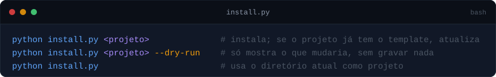

<details>
<summary>Copiar comandos</summary>

```sh
python install.py <projeto>              # instala; se o projeto já tem o template, atualiza
python install.py <projeto> --dry-run    # só mostra o que mudaria, sem gravar nada
python install.py                        # usa o diretório atual como projeto
python install.py <projeto> --mod token-handoff                      # instala também um mod do Claude Code, só neste projeto
python install.py <projeto> --mod token-handoff --mod-scope global   # ... ou para todos os projetos do usuário
```

</details>

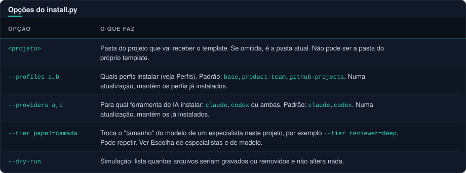

<details>
<summary>Ver como texto</summary>

| Opção | O que faz |
| --- | --- |
| `<projeto>` | Pasta do projeto que vai receber o template. Se omitida, é a pasta atual. Não pode ser a pasta do próprio template. |
| `--profiles a,b` | Quais perfis instalar (veja [Perfis](#perfis)). Padrão: `base,product-team,github-projects`. Numa atualização, mantém os perfis já instalados. |
| `--providers a,b` | Para qual ferramenta de IA instalar: `claude`, `codex` ou ambas. Padrão: `claude,codex`. Numa atualização, mantém os já instalados. |
| `--tier papel=camada` | Troca o "tamanho" do modelo de um especialista neste projeto, por exemplo `--tier reviewer=deep`. Pode repetir. Ver [Escolha de especialistas e de modelo](#escolha-de-especialistas-e-de-modelo). |
| `--dry-run` | Simulação: lista quantos arquivos seriam gravados ou removidos e não altera nada. |

</details>

Ao terminar, o instalador roda a verificação (`check`) sozinho. Se algum arquivo do projeto conflitar com o template, ele para com uma mensagem e não grava nada pela metade.

**Instalar tudo.** Não existe uma opção `--all`, porque dois perfis são alternativas entre si: `hosting-managed` (hospedagem gerenciada) e `vps-k3s` (servidor próprio com containers). Escolha um dos dois e instale todo o resto:

```sh
python install.py <projeto> --profiles base,github-projects,product-team,polyrepo,session-continuity,nestjs-mikroorm,python,aws-serverless,hosting-managed
```

Na prática, instale só os perfis de stack (`nestjs-mikroorm`, `python`, `aws-serverless`, `hosting-managed`, `vps-k3s`) que o seu projeto realmente usa.

### CLI completa: `scripts/template.py`

Execute a partir da raiz deste pacote. Cada comando tem um propósito:

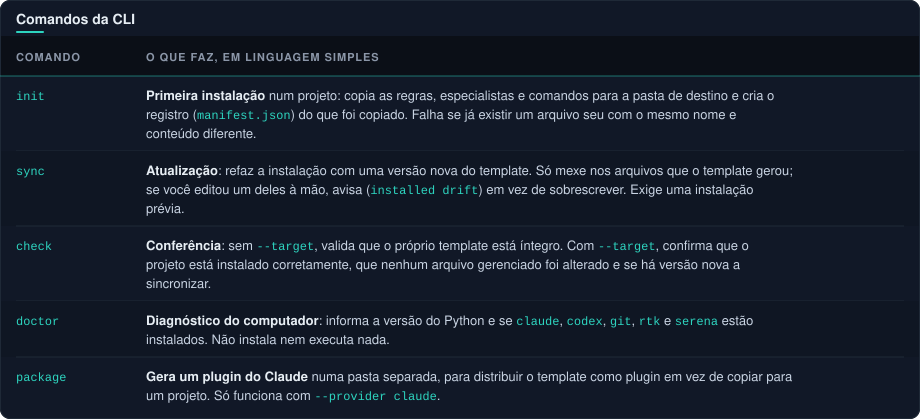

<details>
<summary>Ver como texto</summary>

| Comando | O que faz, em linguagem simples |
| --- | --- |
| `init` | **Primeira instalação** num projeto: copia as regras, especialistas e comandos para a pasta de destino e cria o registro (`manifest.json`) do que foi copiado. Falha se já existir um arquivo seu com o mesmo nome e conteúdo diferente. |
| `sync` | **Atualização**: refaz a instalação com uma versão nova do template. Só mexe nos arquivos que o template gerou; se você editou um deles à mão, avisa (`installed drift`) em vez de sobrescrever. Exige uma instalação prévia. |
| `check` | **Conferência**: sem `--target`, valida que o próprio template está íntegro. Com `--target`, confirma que o projeto está instalado corretamente, que nenhum arquivo gerenciado foi alterado e se há versão nova a sincronizar. |
| `doctor` | **Diagnóstico do computador**: informa a versão do Python e se `claude`, `codex`, `git`, `rtk` e `serena` estão instalados. Não instala nem executa nada. |
| `package` | **Gera um plugin do Claude** numa pasta separada, para distribuir o template como plugin em vez de copiar para um projeto. Só funciona com `--provider claude`. |

</details>

Opções comuns (`init`, `sync` e `package`):

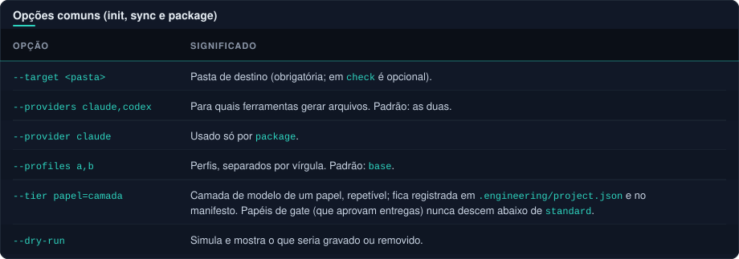

<details>
<summary>Ver como texto</summary>

| Opção | Significado |
| --- | --- |
| `--target <pasta>` | Pasta de destino (obrigatória; em `check` é opcional). |
| `--providers claude,codex` | Para quais ferramentas gerar arquivos. Padrão: as duas. |
| `--provider claude` | Usado só por `package`. |
| `--profiles a,b` | Perfis, separados por vírgula. Padrão: `base`. |
| `--tier papel=camada` | Camada de modelo de um papel, repetível; fica registrada em `.engineering/project.json` e no manifesto. Papéis de gate (que aprovam entregas) nunca descem abaixo de `standard`. |
| `--dry-run` | Simula e mostra o que seria gravado ou removido. |

</details>

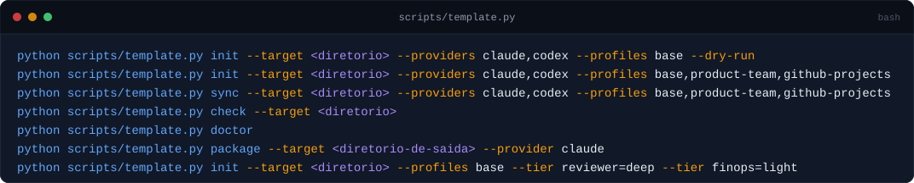

<details>
<summary>Copiar comandos</summary>

```sh
python scripts/template.py init --target <diretorio> --providers claude,codex --profiles base --dry-run
python scripts/template.py init --target <diretorio> --providers claude,codex --profiles base,product-team,github-projects
python scripts/template.py sync --target <diretorio> --providers claude,codex --profiles base,product-team,github-projects
python scripts/template.py check --target <diretorio>
python scripts/template.py doctor
python scripts/template.py package --target <diretorio-de-saida> --provider claude
python scripts/template.py init --target <diretorio> --profiles base --tier reviewer=deep --tier finops=light
```

</details>

Revise sempre `--dry-run` primeiro; conflitos locais devem ser resolvidos explicitamente.

### O que é gravado no projeto

- `.engineering/`: o conhecimento compartilhado (papéis, ações, políticas, workflow, modelos de documento, perfis e integrações), mais `project.json` (suas escolhas) e `manifest.json` (a lista do que foi instalado, com impressão digital de cada arquivo).
- `CLAUDE.md` e `AGENTS.md`: instruções de partida para o Claude Code e para o Codex.
- `.claude/agents`, `.claude/commands` e `.claude/skills`: especialistas (com o modelo de cada um), comandos `/qa`, `/security`, `/story`… e skills do Claude.
- `.codex/agents` (TOML, com esforço de raciocínio) e `.agents/skills`: o equivalente para o Codex.

Nada é instalado no computador nem em configurações globais, e integrações externas não são ativadas. Consulte [compatibilidade](docs/compatibility.md) antes de habilitar e a [receita do adapter Claude](adapters/claude/README.md) para consumir o plugin.

<a id="como-funciona"></a>

##  Como funciona


- **Entender antes de fazer.** A demanda vira uma história pronta (DoR), passa por entendimento e desenho, plano e staffing.
- **Especialistas executam.** Implementação por especialistas, cada um em um worktree isolado, com o modelo mais barato que dá conta.
- **Revisão independente.** Correção dos apontamentos e nova revisão até aprovação; QA e segurança, e privacidade quando há dados pessoais, são gates obrigatórios.
- **Evidência, não promessa.** Verificação executada vem com resultado e limites; arquivos presentes ou testes verdes não comprovam deploy nem aceitação manual. `completed` é do principal, após verificar evidência; `accepted` é do usuário.

> [!NOTE]
> O principal delega somente quando a sessão e o runtime autorizam subagentes. Se a capacidade estiver indisponível, coordene sessões especialistas independentes verificadas ou registre o impedimento; o principal não assume implementação nem parecer especializado. Produção, migrações e operações destrutivas seguem os gates explícitos do projeto e a autorização vigente.

<details>
<summary><b>Guia visual completo: 17 diagramas animados</b></summary>

A pasta [assets/](assets/) traz o passo a passo do template em 17 diagramas animados. Cada diagrama aparece, animado, direto na página do [guia dos diagramas](docs/diagramas.md) (os links da tabela levam à etapa). Os mesmos desenhos existem como HTML autocontido em `assets/svg-*.html` para abrir no navegador, sem servidor, e como SVG em `assets/diagramas/`. Comece pelo [fluxo macro](docs/diagramas.md#fluxo-macro).

| Etapa | Diagrama | O que mostra |
| --- | --- | --- |
| 01 | [Instalação](docs/diagramas.md#etapa-01--instalação) | Pré-requisitos, `init`, seleção de perfis, provedores e estrutura de pastas gerada. |
| 02 | [Perfis](docs/diagramas.md#etapa-02--perfis) | Como os perfis se empilham sobre o `base` e quais conflitam. |
| 03 | [Planejamento e brainstorm](docs/diagramas.md#etapa-03--planejamento-e-brainstorm) | Da demanda bruta à especificação aprovada pelo humano. |
| 04 | [Requisitos e histórias](docs/diagramas.md#etapa-04--requisitos-e-histórias) | História com critérios Given/When/Then, Definition of Ready e Definition of Done. |
| 05 | [Staffing](docs/diagramas.md#etapa-05--staffing) | Como o principal escolhe especialistas e modelo para cada tarefa. |
| 06 | [Camadas de modelo](docs/diagramas.md#etapa-06--camadas-de-modelo) | `deep`, `standard` e `light`, e as regras de economia de tokens. |
| 07 | [Execução e worktrees](docs/diagramas.md#etapa-07--execução-e-worktrees) | Um worktree isolado por agente: brief, implementação, handoff e PR. |
| 08 | [Gates independentes](docs/diagramas.md#etapa-08--gates-independentes) | Revisão técnica, segurança e privacidade em paralelo, depois QA final. |
| 09 | [Ciclo de correção](docs/diagramas.md#etapa-09--ciclo-de-correção) | Rejeição com causa e evidência, novo agente e revalidação. |
| 10 | [LGPD/GDPR](docs/diagramas.md#etapa-10--lgpdgdpr) | Base legal, finalidade, minimização, retenção e direitos do titular. |
| 11 | [Design, UX e usuários leigos](docs/diagramas.md#etapa-11--design-ux-e-usuários-leigos) | Telas, marca, acessibilidade e rodada de usabilidade simulada. |
| 12 | [Infra e CI/CD](docs/diagramas.md#etapa-12--infra-e-cicd) | Especialistas de plataforma: AWS, hospedagem, Kubernetes, SRE, CI/CD e IaC. |
| 13 | [GitHub Projects](docs/diagramas.md#etapa-13--github-projects) | Os nove estados do quadro, campos e registro de eventos. |
| 14 | [Continuidade de sessão](docs/diagramas.md#etapa-14--continuidade-de-sessão) | Marcos de tokens, diário, estado vivo e retomada após queda. |
| 15 | [Segurança](docs/diagramas.md#etapa-15--segurança) | Revisão de código novo, varredura de segredos e decisão humana em alertas. |
| 16 | [Métodos ágeis e Git](docs/diagramas.md#etapa-16--métodos-ágeis-e-git) | Sprint, hierarquia de issues, worktrees, polyrepo e commits convencionais. |
| 17 | [Orquestração](docs/diagramas.md#etapa-17--orquestração) | O principal coordena e nunca implementa; os 28 especialistas em grupos. |

Extras: o [fluxo de embedding](assets/svg-embedding-flow.html) é um exemplo avulso (como texto vira vetor e é buscado num banco vetorial), não faz parte do template, e [svg-index-engineering-template.xlsx](assets/svg-index-engineering-template.xlsx) é o índice dos diagramas em planilha. Os nomes de agentes dentro dos diagramas são ilustrativos; os papéis reais e seus ids estão em `core/roles/` e em `template.json`. Para o fluxo de implementação e as regras dos agentes explicados em profundidade, etapa por etapa, leia o **[guia dos diagramas](docs/diagramas.md)**. Para criar novos diagramas no mesmo estilo, use a skill [`dark-pipeline-svg`](core/skills/dark-pipeline-svg/SKILL.md).

</details>

<a id="perfis"></a>

##  Perfis

**Em linguagem simples:** um perfil é um *pacote opcional de regras* que você liga ou desliga na instalação. O `base` é o motor comum; os demais ensinam ao time de IA como trabalhar num contexto específico (um jeito de gerir produto, uma tecnologia, um tipo de hospedagem). Só o que você escolher passa a valer, e a stack, a nuvem e o produto vêm dos perfis e do seu repositório, nunca do template. Escolher um perfil não instala nenhum programa.

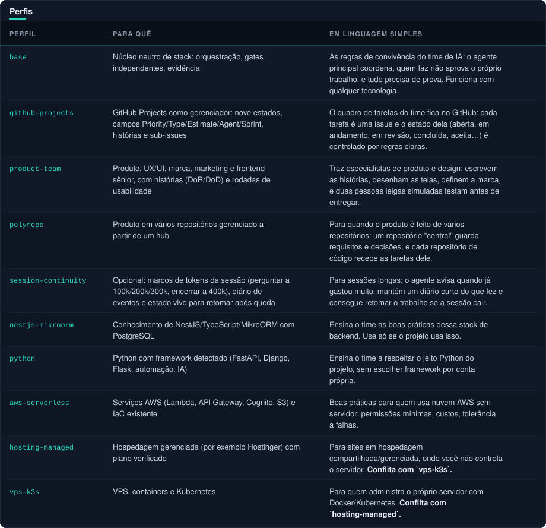

<details>
<summary>Ver como texto</summary>

| Perfil | Para quê | Em linguagem simples |
| --- | --- | --- |
| `base` | Núcleo neutro de stack: orquestração, gates independentes, evidência | As regras de convivência do time de IA: o agente principal coordena, quem faz não aprova o próprio trabalho, e tudo precisa de prova. Funciona com qualquer tecnologia. |
| `github-projects` | GitHub Projects como gerenciador: nove estados, campos Priority/Type/Estimate/Agent/Sprint, histórias e sub-issues | O quadro de tarefas do time fica no GitHub: cada tarefa é uma issue e o estado dela (aberta, em andamento, em revisão, concluída, aceita…) é controlado por regras claras. |
| `product-team` | Produto, UX/UI, marca, marketing e frontend sênior, com histórias (DoR/DoD) e rodadas de usabilidade | Traz especialistas de produto e design: escrevem as histórias, desenham as telas, definem a marca, e duas pessoas leigas simuladas testam antes de entregar. |
| `polyrepo` | Produto em vários repositórios gerenciado a partir de um hub | Para quando o produto é feito de vários repositórios: um repositório "central" guarda requisitos e decisões, e cada repositório de código recebe as tarefas dele. |
| `session-continuity` | Opcional: marcos de tokens da sessão (perguntar a 100k/200k/300k, encerrar a 400k), diário de eventos e estado vivo para retomar após queda | Para sessões longas: o agente avisa quando já gastou muito, mantém um diário curto do que fez e consegue retomar o trabalho se a sessão cair. |
| `nestjs-mikroorm` | Conhecimento de NestJS/TypeScript/MikroORM com PostgreSQL | Ensina o time as boas práticas dessa stack de backend. Use só se o projeto usa isso. |
| `python` | Python com framework detectado (FastAPI, Django, Flask, automação, IA) | Ensina o time a respeitar o jeito Python do projeto, sem escolher framework por conta própria. |
| `aws-serverless` | Serviços AWS (Lambda, API Gateway, Cognito, S3) e IaC existente | Boas práticas para quem usa nuvem AWS sem servidor: permissões mínimas, custos, tolerância a falhas. |
| `hosting-managed` | Hospedagem gerenciada (por exemplo Hostinger) com plano verificado | Para sites em hospedagem compartilhada/gerenciada, onde você não controla o servidor. **Conflita com `vps-k3s`.** |
| `vps-k3s` | VPS, containers e Kubernetes | Para quem administra o próprio servidor com Docker/Kubernetes. **Conflita com `hosting-managed`.** |

</details>

<a id="quem-faz-o-quê"></a>

##  Quem faz o quê

O agente principal é sempre o orquestrador e nunca substitui um especialista. Expertise responde ao domínio; função responde ao papel naquela etapa (autor, consultor, QA, revisão, segurança, privacidade, verificador). Ninguém aprova o próprio trabalho.

<table>
  <tr>
    <td width="50%" valign="top"></td>
    <td width="50%" valign="top"></td>
  </tr>
</table>

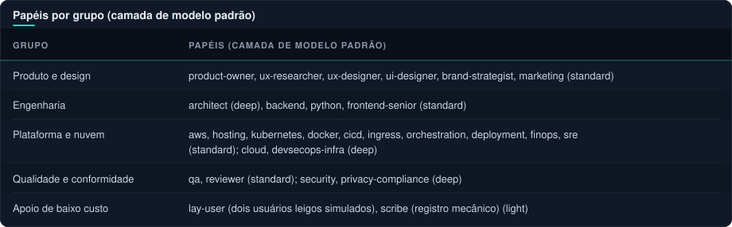

<details>
<summary>Ver como texto</summary>

| Grupo | Papéis (camada de modelo padrão) |
| --- | --- |
| Produto e design | product-owner, ux-researcher, ux-designer, ui-designer, brand-strategist, marketing (standard) |
| Engenharia | architect (deep), backend, python, frontend-senior (standard) |
| Plataforma e nuvem | aws, hosting, kubernetes, docker, cicd, ingress, orchestration, deployment, finops, sre (standard); cloud, devsecops-infra (deep) |
| Qualidade e conformidade | qa, reviewer (standard); security, privacy-compliance (deep) |
| Apoio de baixo custo | lay-user (dois usuários leigos simulados), scribe (registro mecânico) (light) |

</details>

São 28 papéis e 11 ações rápidas: qa, security, aws, hosting, kubernetes, sre, cicd, devsecops-infra, **story**, **usability** e **privacy**. O catálogo canônico (`template.json`) define papéis, camadas, ações e skills; as skills `drawio-diagram` (diagramas editáveis), `dark-pipeline-svg` (diagramas animados) e `readme-styling` (README e markdowns estilizados) cobrem diagramas e documentação.

<a id="escolha-de-especialistas-e-de-modelo"></a>

###  Escolha de especialistas e de modelo

`core/workflow/staffing.md` e `core/policies/models.md` mandam o principal decidir por tarefa, registrando no brief:

- **Especialista:** o mais qualificado para o domínio, a stack e o risco; lacuna vira proposta (adaptar, criar papel ou agente externo aprovado), nunca substituição silenciosa.
- **Camada de modelo:** `deep` (Opus) para os problemas mais difíceis e decisões de segurança, privacidade e arquitetura; `standard` (Sonnet) como padrão do trabalho dos especialistas; `light` (Haiku) para tarefas mecânicas e para os usuários leigos simulados. Sobe de camada por evidência (duas falhas, risco, ambiguidade), desce depois da decisão difícil registrada. Gates nunca ficam abaixo de `standard`, e não se remove gate para economizar tokens.
- **Economia de tokens:** contexto focado, um especialista por pergunta, paralelismo só em escopos disjuntos, reaproveitamento de evidências. Regras completas em `core/workflow/economy.md` (um autor por vez, brief por referência, handoff em arquivo, não retomar agente pesado, suíte completa só no fim): muda como se executa, nunca se verifica.

<a id="processos"></a>

##  Processos do dia a dia

<table>
  <tr>
    <td width="50%" valign="top">
      <h3> GitHub Projects</h3>
      <p>Cada card é uma issue num único Project com Status (open, pending, in-progress, in-review, rejected, blocked, completed, accepted, closed), Priority, Type, Estimate, Agent, Sprint, Due date e Completed at. Contrato em <code>core/workflow/github-projects.md</code>.</p>
    </td>
    <td width="50%" valign="top">
      <h3> Épicos e histórias</h3>
      <p>Segue <code>core/workflow/user-stories.md</code> e a ação <code>/story</code>. O principal só despacha uma história que cumpre o <b>DoR</b> e só a marca <code>completed</code> depois do <b>DoD</b> e da re-execução de uma evidência. <code>integrations/github-projects</code> cria o Project, os campos e os labels.</p>
    </td>
  </tr>
  <tr>
    <td width="50%" valign="top">
      <h3> Usabilidade com usuários leigos</h3>
      <p>Ação <code>/usability</code>: o <code>ux-researcher</code> prepara personas e tarefas; <b>dois</b> <code>lay-user</code> na camada mais fraca, sem acesso a código, tokens ou contratos, relatam onde travaram. A decisão segue a precedência: saúde e segurança do usuário e leis (LGPD/GDPR, consumo), regras de negócio, usabilidade, copy, preferência. Pontos jurídicos ficam <code>LEGAL-REVIEW</code>. Sem dark patterns; usuários simulados não substituem reais em fluxos de risco.</p>
    </td>
    <td width="50%" valign="top">
      <h3> Vários repositórios</h3>
      <p>Perfil <code>polyrepo</code> (<code>core/workflow/polyrepo.md</code>): um repositório hub guarda requisitos, ADRs, specs, planos, sprints, runbooks, registro de instalações e decisões; as tarefas ficam em cada repositório de código e voltam ao hub; contratos e pacotes compartilhados são publicados antes dos consumidores; cada repositório recebe o mesmo bootstrap.</p>
    </td>
  </tr>
  <tr>
    <td width="50%" valign="top">
      <h3> Continuidade de sessão</h3>
      <p>Perfil opcional <code>session-continuity</code> (<code>core/workflow/session-continuity.md</code>): marcos de tokens configuráveis, diário de eventos só de acréscimo, estado vivo curto e retomada após queda (agente em andamento é dado por perdido, nunca retomado). <code>core/policies/communication.md</code>: IDs com link para arquivo e linha, nome por extenso, frase simples e perguntas sempre com recomendação. O contador automático é opcional e instalado só com <code>--mod token-handoff</code> (<a href="integrations/mod/token-handoff/README.md">token-handoff</a>: age só aos 400k, sem perguntas, abre a sessão nova e encerra a atual; testado por unidade, não verificado em sessão real). A especificação original está em <a href="integrations/token-milestones/README.md">token-milestones</a>.</p>
    </td>
    <td width="50%" valign="top">
      <h3> Qualidade de entrega</h3>
      <p><code>core/policies/quality-principles.md</code>: reaproveitar antes de construir, operações idempotentes, modos de falha nomeados (timeout, retry com backoff, fallback, rollback), escalabilidade, simplicidade e custo, segurança e privacidade por padrão e evidência na versão final. <code>core/policies/installations.md</code>: nada é instalado sem proposta, critérios de segurança e popularidade, aprovação explícita e registro em <code>docs/operations/registro-instalacoes.md</code>.</p>
    </td>
  </tr>
</table>

<a id="integracoes"></a>

##  Integrações opcionais

- [Plugins e agentes recomendados](integrations/plugins/README.md): curadoria de UI/UX, marca, marketing, produto e frontend com origem, popularidade verificada e comandos; **nada é instalado pelo template**.
- [Serena](integrations/serena/README.md): projeto sanitizado e snippets MCP para ambos os provedores.
- [RTK](integrations/rtk/INSTRUCTIONS.md): uso explícito, sem interceptação automática no Codex.
- [Superpowers](integrations/superpowers/README.md): mapeamento das skills de workflow, sem redistribuir plugin.
- [Voltagent](integrations/voltagent/README.md): catálogo de pacotes de agentes, configured_not_verified.
- [GitHub Projects](integrations/github-projects/README.md): scripts para criar o Project com os campos do contrato e os labels padrão; workflows automáticos desligados na interface.
- [Mods do Claude Code](integrations/mod/README.md): `install.py --mod <nome>`; o primeiro é o `token-handoff`.
- [Configuração Claude](integrations/claude/settings.json): worktree.baseRef=head, sem permissões de commit pré-concedidas.

> [!WARNING]
> Não copie credenciais, endpoints privados, caches, memórias ou configurações globais. Nenhuma dependência externa é instalada pelo pacote. A descoberta real de agentes e skills, o respeito aos campos de modelo e a paridade de execução entre os provedores continuam pendentes de teste no runtime local.

<a id="estrutura"></a>

##  Estrutura do projeto

<details>
<summary><b>Árvore do template</b></summary>

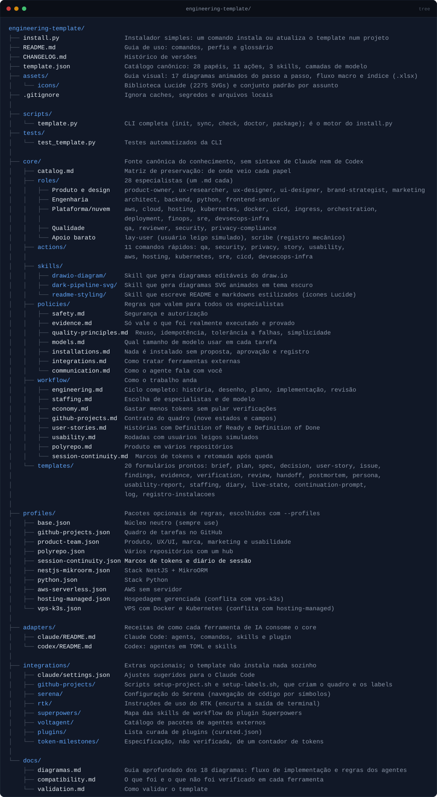

<details>
<summary>Copiar árvore</summary>

```
engineering-template/
├── install.py                  Instalador simples: um comando instala ou atualiza o template num projeto
├── README.md                   Guia de uso: comandos, perfis e glossário
├── CHANGELOG.md                Histórico de versões
├── template.json               Catálogo canônico: 28 papéis, 11 ações, 3 skills, camadas de modelo
├── assets/                     Guia visual: 17 diagramas animados do passo a passo, fluxo macro e índice (.xlsx)
│   ├── diagramas/              Os mesmos diagramas em SVG puro, exibidos em docs/diagramas.md
│   └── icons/                  Biblioteca Lucide (2275 SVGs) e conjunto padrão por assunto
├── .gitignore                  Ignora caches, segredos e arquivos locais
│
├── scripts/
│   └── template.py             CLI completa (init, sync, check, doctor, package); é o motor do install.py
├── tests/
│   └── test_template.py        Testes automatizados da CLI
│
├── core/                       Fonte canônica do conhecimento, sem sintaxe de Claude nem de Codex
│   ├── catalog.md              Matriz de preservação: de onde veio cada papel
│   ├── roles/                  28 especialistas (um .md cada)
│   │   ├── Produto e design    product-owner, ux-researcher, ux-designer, ui-designer, brand-strategist, marketing
│   │   ├── Engenharia          architect, backend, python, frontend-senior
│   │   ├── Plataforma/nuvem    aws, cloud, hosting, kubernetes, docker, cicd, ingress, orchestration,
│   │   │                       deployment, finops, sre, devsecops-infra
│   │   ├── Qualidade           qa, reviewer, security, privacy-compliance
│   │   └── Apoio barato        lay-user (usuário leigo simulado), scribe (registro mecânico)
│   ├── actions/                11 comandos rápidos: qa, security, privacy, story, usability,
│   │                           aws, hosting, kubernetes, sre, cicd, devsecops-infra
│   ├── skills/
│   │   ├── drawio-diagram/     Skill que gera diagramas editáveis do draw.io
│   │   ├── dark-pipeline-svg/  Skill que gera diagramas SVG animados em tema escuro
│   │   └── readme-styling/     Skill que escreve README e markdowns estilizados (ícones Lucide)
│   ├── policies/               Regras que valem para todos os especialistas
│   │   ├── safety.md           Segurança e autorização
│   │   ├── evidence.md         Só vale o que foi realmente executado e provado
│   │   ├── quality-principles.md  Reuso, idempotência, tolerância a falhas, simplicidade
│   │   ├── models.md           Qual tamanho de modelo usar em cada tarefa
│   │   ├── installations.md    Nada é instalado sem proposta, aprovação e registro
│   │   ├── integrations.md     Como tratar ferramentas externas
│   │   └── communication.md    Como o agente fala com você
│   ├── workflow/               Como o trabalho anda
│   │   ├── engineering.md      Ciclo completo: história, desenho, plano, implementação, revisão
│   │   ├── staffing.md         Escolha de especialistas e de modelo
│   │   ├── economy.md          Gastar menos tokens sem pular verificações
│   │   ├── github-projects.md  Contrato do quadro (nove estados e campos)
│   │   ├── user-stories.md     Histórias com Definition of Ready e Definition of Done
│   │   ├── usability.md        Rodadas com usuários leigos simulados
│   │   ├── polyrepo.md         Produto em vários repositórios
│   │   └── session-continuity.md  Marcos de tokens e retomada após queda
│   └── templates/              20 formulários prontos: brief, plan, spec, decision, user-story, issue,
│                               findings, evidence, verification, review, handoff, postmortem, persona,
│                               usability-report, staffing, diary, live-state, continuation-prompt,
│                               log, registro-instalacoes
│
├── profiles/                   Pacotes opcionais de regras, escolhidos com --profiles
│   ├── base.json               Núcleo neutro (sempre use)
│   ├── github-projects.json    Quadro de tarefas no GitHub
│   ├── product-team.json       Produto, UX/UI, marca, marketing e usabilidade
│   ├── polyrepo.json           Vários repositórios com um hub
│   ├── session-continuity.json Marcos de tokens e diário de sessão
│   ├── nestjs-mikroorm.json    Stack NestJS + MikroORM
│   ├── python.json             Stack Python
│   ├── aws-serverless.json     AWS sem servidor
│   ├── hosting-managed.json    Hospedagem gerenciada (conflita com vps-k3s)
│   └── vps-k3s.json            VPS com Docker e Kubernetes (conflita com hosting-managed)
│
├── adapters/                   Receitas de como cada ferramenta de IA consome o core
│   ├── claude/README.md        Claude Code: agents, comandos, skills e plugin
│   └── codex/README.md         Codex: agentes em TOML e skills
│
├── integrations/               Extras opcionais; o template não instala nada sozinho
│   ├── claude/settings.json    Ajustes sugeridos para o Claude Code
│   ├── github-projects/        Scripts setup-project.sh e setup-labels.sh, que criam o quadro e os labels
│   ├── serena/                 Configuração do Serena (navegação de código por símbolos)
│   ├── rtk/                    Instruções de uso do RTK (encurta a saída de terminal)
│   ├── superpowers/            Mapa das skills de workflow do plugin Superpowers
│   ├── voltagent/              Catálogo de pacotes de agentes externos
│   ├── plugins/                Lista curada de plugins (curated.json)
│   ├── mod/                    Mods do Claude Code, instalados com install.py --mod
│   └── token-milestones/       Especificação, não verificada, de um contador de tokens
│
└── docs/
    ├── diagramas.md            Guia aprofundado dos 18 diagramas: fluxo de implementação e regras dos agentes
    ├── compatibility.md        O que foi e o que não foi verificado em cada ferramenta
    └── validation.md           Como validar o template
```

</details>

</details>

O que uma instalação gera no projeto de destino:

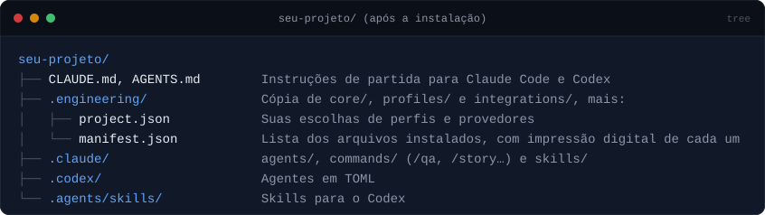

<details>
<summary>Copiar árvore</summary>

```
seu-projeto/
├── CLAUDE.md, AGENTS.md        Instruções de partida para Claude Code e Codex
├── .engineering/               Cópia de core/, profiles/ e integrations/, mais:
│   ├── project.json            Suas escolhas de perfis e provedores
│   └── manifest.json           Lista dos arquivos instalados, com impressão digital de cada um
├── .claude/                    agents/, commands/ (/qa, /story…) e skills/
├── .codex/                     Agentes em TOML
└── .agents/skills/             Skills para o Codex
```

</details>

<a id="glossario"></a>

##  Glossário em linguagem simples

Tudo o que o template instala em `.engineering/` e nas pastas do Claude e do Codex, explicado sem jargão.

<details>
<summary><b>Abrir o glossário</b></summary>

#### Comandos rápidos (ações)

Atalhos que você digita no Claude Code (por exemplo `/qa`) ou invoca como skill no Codex. Cada um chama **um especialista** para uma tarefa pontual, sem passar pelo fluxo completo de uma funcionalidade.

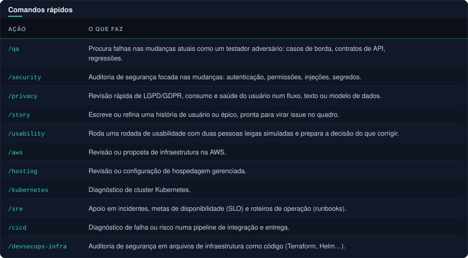

<details>
<summary>Ver como texto</summary>

| Ação | O que faz |
| --- | --- |
| `/qa` | Procura falhas nas mudanças atuais como um testador adversário: casos de borda, contratos de API, regressões. |
| `/security` | Auditoria de segurança focada nas mudanças: autenticação, permissões, injeções, segredos. |
| `/privacy` | Revisão rápida de LGPD/GDPR, consumo e saúde do usuário num fluxo, texto ou modelo de dados. |
| `/story` | Escreve ou refina uma história de usuário ou épico, pronta para virar issue no quadro. |
| `/usability` | Roda uma rodada de usabilidade com duas pessoas leigas simuladas e prepara a decisão do que corrigir. |
| `/aws` | Revisão ou proposta de infraestrutura na AWS. |
| `/hosting` | Revisão ou configuração de hospedagem gerenciada. |
| `/kubernetes` | Diagnóstico de cluster Kubernetes. |
| `/sre` | Apoio em incidentes, metas de disponibilidade (SLO) e roteiros de operação (runbooks). |
| `/cicd` | Diagnóstico de falha ou risco numa pipeline de integração e entrega. |
| `/devsecops-infra` | Auditoria de segurança em arquivos de infraestrutura como código (Terraform, Helm…). |

</details>

#### Papéis (especialistas)

São os "funcionários" de IA, 28 no total (lista completa na seção [Quem faz o quê](#quem-faz-o-quê)). O **agente principal** é o gerente: entende o pedido, escolhe quem faz, e nunca faz nem aprova o trabalho no lugar deles. Cada papel tem uma **camada de modelo**: `deep` (mais capaz e caro, para decisões difíceis), `standard` (o padrão) e `light` (barato, para tarefas mecânicas).

#### Skills

Uma *skill* é um pacote de instruções que o agente carrega só quando a tarefa pede, para não gastar contexto à toa. O template traz três:

- **`drawio-diagram`**: gera diagramas editáveis do draw.io (fluxo de login, infraestrutura, rede de containers, mapa de serviços) a partir do que está no projeto.
- **`dark-pipeline-svg`**: gera diagramas SVG animados (HTML autocontido, tema escuro, cores por grupo, cabeçalho, barra de status e legenda) no estilo dos diagramas de [assets/](assets/). Serve para documentar fluxos e arquiteturas de forma didática, para ler no navegador. Também gera **gráficos animados** (barra empilhada de porcentagens, barras horizontais e donut) a partir de um JSON, com qualquer número de itens, valores e cores, pelo script `scripts/chart.py` da skill. E cria **banners de título de projeto** (nome, subtítulo, stack e um painel animado que muda conforme o projeto: terminal com comandos, trecho de código, pipeline, métricas ou arquitetura de serviços), usando a paleta do próprio projeto quando existe, pelo script `scripts/hero.py`.

- **`readme-styling`**: escreve README e outros markdowns com visual de portfólio (banner animado, badges, grids, código com coloração, ícones [Lucide](https://lucide.dev/) de [assets/icons/](assets/icons/README.md)), usando a `dark-pipeline-svg` para banner, diagramas e gráficos. Este README foi feito com ela.

Quando usar qual: `drawio-diagram` para diagrama que alguém vai **editar** depois; `dark-pipeline-svg` para diagrama **apresentável e animado**.

As ações acima também ficam disponíveis como skills no Codex (`.agents/skills`).

#### Políticas

Regras que valem para **todos** os especialistas, em `.engineering/policies/`:

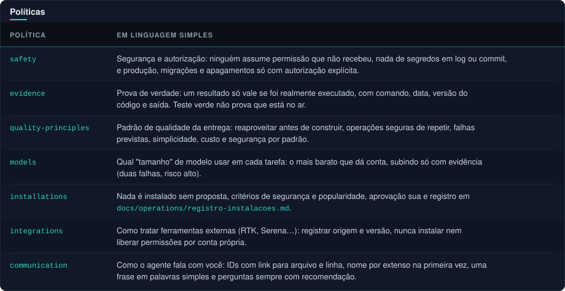

<details>
<summary>Ver como texto</summary>

| Política | Em linguagem simples |
| --- | --- |
| `safety` | Segurança e autorização: ninguém assume permissão que não recebeu, nada de segredos em log ou commit, e produção, migrações e apagamentos só com autorização explícita. |
| `evidence` | Prova de verdade: um resultado só vale se foi realmente executado, com comando, data, versão do código e saída. Teste verde não prova que está no ar. |
| `quality-principles` | Padrão de qualidade da entrega: reaproveitar antes de construir, operações seguras de repetir, falhas previstas, simplicidade, custo e segurança por padrão. |
| `models` | Qual "tamanho" de modelo usar em cada tarefa: o mais barato que dá conta, subindo só com evidência (duas falhas, risco alto). |
| `installations` | Nada é instalado sem proposta, critérios de segurança e popularidade, aprovação sua e registro em `docs/operations/registro-instalacoes.md`. |
| `integrations` | Como tratar ferramentas externas (RTK, Serena…): registrar origem e versão, nunca instalar nem liberar permissões por conta própria. |
| `communication` | Como o agente fala com você: IDs com link para arquivo e linha, nome por extenso na primeira vez, uma frase em palavras simples e perguntas sempre com recomendação. |
| `versioning` | Toda mudança que entra na `main` ganha antes uma tag SemVer (`vMAJOR.MINOR.PATCH`) criada e publicada **antes** do código; vale para merge, push, commit ou qualquer outro caminho, dentro do escopo e da autorização do agente. Quem tagueia é o principal, nunca o autor da própria entrega. |

</details>

#### Fluxos de trabalho (workflow)

Em `.engineering/workflow/`, descrevem *como* o trabalho anda:

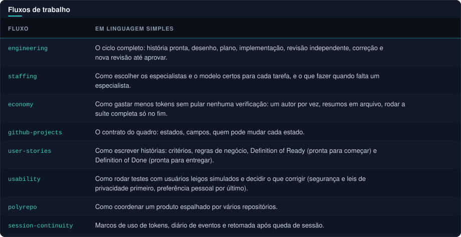

<details>
<summary>Ver como texto</summary>

| Fluxo | Em linguagem simples |
| --- | --- |
| `engineering` | O ciclo completo: história pronta, desenho, plano, implementação, revisão independente, correção e nova revisão até aprovar. |
| `staffing` | Como escolher os especialistas e o modelo certos para cada tarefa, e o que fazer quando falta um especialista. |
| `economy` | Como gastar menos tokens sem pular nenhuma verificação: um autor por vez, resumos em arquivo, rodar a suíte completa só no fim. |
| `github-projects` | O contrato do quadro: estados, campos, quem pode mudar cada estado. |
| `user-stories` | Como escrever histórias: critérios, regras de negócio, Definition of Ready (pronta para começar) e Definition of Done (pronta para entregar). |
| `usability` | Como rodar testes com usuários leigos simulados e decidir o que corrigir (segurança e leis de privacidade primeiro, preferência pessoal por último). |
| `polyrepo` | Como coordenar um produto espalhado por vários repositórios. |
| `session-continuity` | Marcos de uso de tokens, diário de eventos e retomada após queda de sessão. |

</details>

#### Modelos de documento (templates)

Em `.engineering/templates/`, formulários prontos que os especialistas preenchem: `brief` (pedido de trabalho), `plan` (plano), `spec` (especificação), `decision` (decisão registrada), `user-story` (história), `issue` (card do quadro), `findings` (achados da revisão), `evidence` (evidência), `verification` (verificação), `review` (revisão), `handoff` (passagem de bastão entre agentes), `postmortem` (análise de incidente), `persona`, `usability-report`, `staffing`, `diary` e `live-state` (continuidade de sessão), `continuation-prompt`, `log` e `registro-instalacoes`.

#### Integrações e ferramentas

Ficam em `.engineering/integrations/` e são **opcionais**: o template só traz instruções e arquivos de configuração, e não instala nada sozinho.

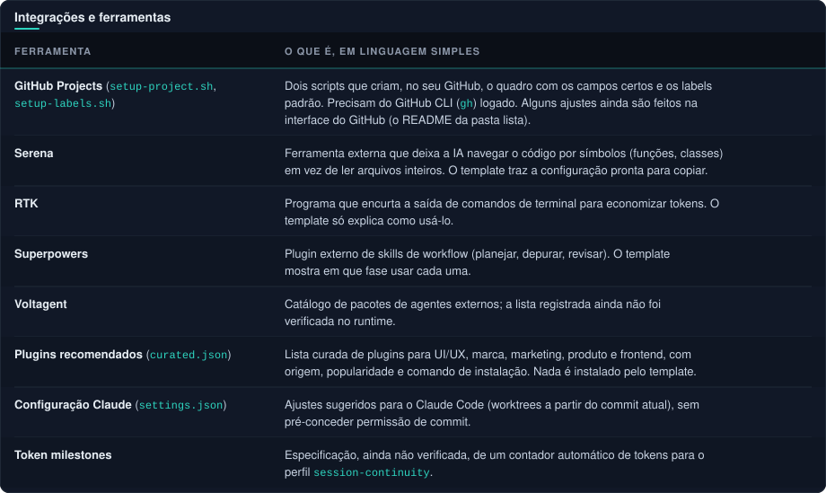

<details>
<summary>Ver como texto</summary>

| Ferramenta | O que é, em linguagem simples |
| --- | --- |
| **GitHub Projects** (`setup-project.sh`, `setup-labels.sh`) | Dois scripts que criam, no seu GitHub, o quadro com os campos certos e os labels padrão. Precisam do GitHub CLI (`gh`) logado. Alguns ajustes ainda são feitos na interface do GitHub (o README da pasta lista). |
| **Serena** | Ferramenta externa que deixa a IA navegar o código por símbolos (funções, classes) em vez de ler arquivos inteiros. O template traz a configuração pronta para copiar. |
| **RTK** | Programa que encurta a saída de comandos de terminal para economizar tokens. O template só explica como usá-lo. |
| **Superpowers** | Plugin externo de skills de workflow (planejar, depurar, revisar). O template mostra em que fase usar cada uma. |
| **Voltagent** | Catálogo de pacotes de agentes externos; a lista registrada ainda não foi verificada no runtime. |
| **Plugins recomendados** (`curated.json`) | Lista curada de plugins para UI/UX, marca, marketing, produto e frontend, com origem, popularidade e comando de instalação. Nada é instalado pelo template. |
| **Configuração Claude** (`settings.json`) | Ajustes sugeridos para o Claude Code (worktrees a partir do commit atual), sem pré-conceder permissão de commit. |
| **Token milestones** | Especificação, ainda não verificada, de um contador automático de tokens para o perfil `session-continuity`. |

</details>

</details>
