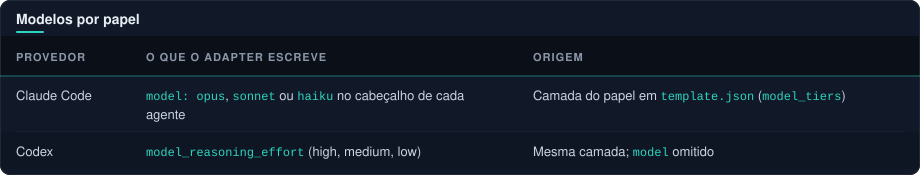
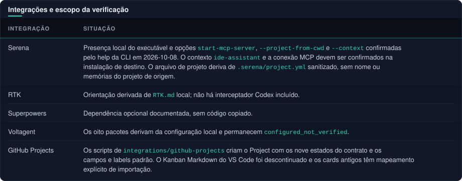

#  Compatibilidade e evidências

  
  
  
  

> [!NOTE]
> As versões acima são contexto de compatibilidade informado na preparação; **não representam uma matriz de runtime integralmente validada.**

[← Voltar ao README](../README.md#sumario) · [Validação](validation.md) · [Guia dos diagramas](diagramas.md)

## Sumário

| Seção | O que cobre |
|---|---|
| [Codex](#codex) | Agentes em TOML, esforço de raciocínio e skills em `.agents/skills` |
| [Claude Code](#claude-code) | Agentes do projeto, plugin e limites de paridade |
| [Modelos por papel](#modelos-por-papel) | Campo `model` por camada e o que ele não prova |
| [Marcos de tokens](#marcos-de-tokens-120) | Especificação sem código validado |
| [Integrações e escopo](#integrações-e-escopo-da-verificação) | Serena, RTK, Superpowers, Voltagent e GitHub Projects |

---

##  Codex

[Configuração de subagentes](https://learn.chatgpt.com/docs/agent-configuration/subagents) descreve arquivos TOML em `.codex/agents` com `name`, `description` e `developer_instructions`.

- O adapter emite `model_reasoning_effort` por papel a partir da camada (`deep`=high, `standard`=medium, `light`=low) e omite `model` para herdar o modelo da sessão.
- O nome do campo e seu efeito dependem da versão do Codex e **não foram verificados em execução**.
- `agents.enabled` é habilitado por padrão segundo essa documentação, mas políticas de sessão ou do processo principal podem restringir delegação e acesso. Um campo de configuração não supera o runtime.

[Skills](https://learn.chatgpt.com/docs/build-skills) documenta `.agents/skills` para skills do projeto. O adapter materializa nesse caminho as skills do catálogo (`drawio-diagram`, `dark-pipeline-svg` e `readme-styling`) e as ações. Descoberta e invocação precisam ser verificadas na sessão de destino.

##  Claude Code

[Subagentes](https://code.claude.com/docs/en/sub-agents) documenta agentes do projeto em `.claude/agents`. [Referência de plugins](https://code.claude.com/docs/en/plugins-reference) descreve os componentes agents, commands, skills e o manifesto `.claude-plugin`. O pacote referencia arquivos de agentes explicitamente no manifesto.

> [!WARNING]
> As capacidades de um agente de plugin diferem das de agentes de projeto: `permissionMode`, `hooks` e `mcpServers` de agentes de plugin são **ignorados** conforme a documentação consultada. Por isso a paridade abrange instruções e catálogo; não promete equivalência de sandbox, permissões ou ferramentas. As integrações MCP permanecem configuração separada do projeto.

**Consumo do plugin.** Exige também disponibilizar seus contratos COMMON em `.engineering` na raiz do consumidor e mesclar `BOOTSTRAP.md` em `CLAUDE.md`. A [receita do adapter](../adapters/claude/README.md) copia a árvore compartilhada sem `manifest.json` e aborta se `.engineering` já existir.

- É exportação para leitura, sem manifesto de instalação gerenciada: `check` e `sync` só se aplicam à raiz do pacote plugin nesse fluxo.
- Os agentes nativos permanecem no plugin.
- Presença de contratos e resolução de caminhos numa fixture não comprovam descoberta nativa nem habilitação automática.

##  Modelos por papel

Ver como texto

| Provedor | O que o adapter escreve | Origem |
|---|---|---|
| Claude Code | `model: opus`, `sonnet` ou `haiku` no cabeçalho de cada agente | Camada do papel em `template.json` (`model_tiers`) |
| Codex | `model_reasoning_effort` (high, medium, low) | Mesma camada; `model` omitido |

O principal pode sobrescrever o modelo por despacho. Nos agentes de plugin o campo `model` é lido do cabeçalho do agente; a documentação consultada deve ser rechecada na versão instalada.

> [!WARNING]
> Um campo gerado nunca prova que o runtime o honrou: confirme com uma sessão real antes de depender dele para custo ou qualidade. Camadas e nomes de modelo mudam com o catálogo do provedor; atualize `model_tiers` em um único lugar.

##  Marcos de tokens (1.2.0)

[integrations/token-milestones/README.md](../integrations/token-milestones/README.md) é uma **especificação**. O template não traz código nem foi validado contra um runtime: o contador de uso da sessão, o bloqueio de despachos e o evento de fim de subagente variam por provedor e versão e precisam ser confirmados na instalação de destino. Sem o mecanismo automático, [session-continuity.md](../core/workflow/session-continuity.md) vale por estimativa do agente.

##  Integrações e escopo da verificação

Ver como texto

| Integração | Situação |
|---|---|
| Serena | Presença local do executável e opções `start-mcp-server`, `--project-from-cwd` e `--context` confirmadas pelo help da CLI em 2026-10-08. O contexto `ide-assistant` e a conexão MCP devem ser confirmados na instalação de destino. O arquivo de projeto deriva de `.serena/project.yml` sanitizado, sem nome ou memórias do projeto de origem. |
| RTK | Orientação derivada de `RTK.md` local; não há interceptador Codex incluído. |
| Superpowers | Dependência opcional documentada, sem código copiado. |
| Voltagent | Os oito pacotes derivam da configuração local e permanecem `configured_not_verified`. |
| GitHub Projects | Os scripts de `integrations/github-projects` criam o Project com os nove estados do contrato e os campos e labels padrão. O Kanban Markdown do VS Code foi descontinuado e os cards antigos têm mapeamento explícito de importação. |

> [!WARNING]
> Arquivos e validação estática **não comprovam** instalação de plugins, conexão de MCP, descoberta de agentes ou skills, revisão independente, renderização do board ou deploy. Testes de descoberta e paridade funcional em sessões novas de ambos os provedores permanecem pendentes. Não use a expressão "runtime totalmente verificado" até haver evidência dessas execuções.
