#  Guia dos diagramas: fluxo de implementação e regras dos agentes

Este documento explica em profundidade os 18 diagramas da pasta [assets/](../assets/) (o fluxo macro e as 17 etapas), todos exibidos aqui em SVG animado (os HTML autocontidos continuam em `assets/` para abrir no navegador): o que cada um desenha, como o trabalho realmente anda e quais regras os agentes seguem. Foi escrito para quem vai **usar ou adaptar o template** e precisa entender o porquê de cada etapa, não só ver o desenho.

  
  
  
  

> [!IMPORTANT]
> **Os diagramas são didáticos; a fonte de verdade é o `core/` e o `template.json`.** Os desenhos usam nomes de agentes (`backend-agent`, `story-agent`…), contagens por grupo, limiares numéricos e ferramentas de exemplo que **não existem no template**. Em cada seção abaixo, o bloco **Regra real** cita o arquivo que manda, e o bloco **Só no desenho** lista o que é ilustração. Quando houver conflito, vale a regra real.

## Sumário

| # | Seção | # | Seção |
|---|---|---|---|
| 0 | [Princípios que valem em todo o fluxo](#princípios-que-valem-em-todo-o-fluxo) | 9 | [Ciclo de correção](#etapa-09--ciclo-de-correção) |
| M | [Fluxo macro](#fluxo-macro) | 10 | [LGPD/GDPR](#etapa-10--lgpdgdpr) |
| 1 | [Instalação](#etapa-01--instalação) | 11 | [Design, UX e usuários leigos](#etapa-11--design-ux-e-usuários-leigos) |
| 2 | [Perfis](#etapa-02--perfis) | 12 | [Infra e CI/CD](#etapa-12--infra-e-cicd) |
| 3 | [Planejamento e brainstorm](#etapa-03--planejamento-e-brainstorm) | 13 | [GitHub Projects](#etapa-13--github-projects) |
| 4 | [Requisitos e histórias](#etapa-04--requisitos-e-histórias) | 14 | [Continuidade de sessão](#etapa-14--continuidade-de-sessão) |
| 5 | [Staffing](#etapa-05--staffing) | 15 | [Segurança](#etapa-15--segurança) |
| 6 | [Camadas de modelo](#etapa-06--camadas-de-modelo) | 16 | [Métodos ágeis e Git](#etapa-16--métodos-ágeis-e-git) |
| 7 | [Execução e worktrees](#etapa-07--execução-e-worktrees) | 17 | [Orquestração](#etapa-17--orquestração) |
| 8 | [Gates independentes](#etapa-08--gates-independentes) | + | [Mapa diagrama → arquivos](#mapa-diagrama--arquivos-de-origem) |

---

## Princípios que valem em todo o fluxo

Estas regras aparecem em quase todos os diagramas. Entendê-las primeiro evita ler cada etapa como se fosse isolada.

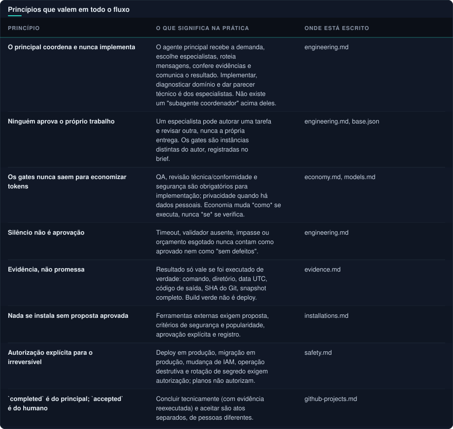

Ver como texto

| Princípio | O que significa na prática | Onde está escrito |
|---|---|---|
| **O principal coordena e nunca implementa** | O agente principal recebe a demanda, escolhe especialistas, roteia mensagens, confere evidências e comunica o resultado. Implementar, diagnosticar domínio e dar parecer técnico é dos especialistas. Não existe um "subagente coordenador" acima deles. | [engineering.md](../core/workflow/engineering.md) |
| **Ninguém aprova o próprio trabalho** | Um especialista pode autorar uma tarefa e revisar outra, nunca a própria entrega. Os gates são instâncias distintas do autor, registradas no brief. | [engineering.md](../core/workflow/engineering.md), [base.json](../profiles/base.json) |
| **Os gates nunca saem para economizar tokens** | QA, revisão técnica/conformidade e segurança são obrigatórios para implementação; privacidade quando há dados pessoais. Economia muda *como* se executa, nunca *se* se verifica. | [economy.md](../core/workflow/economy.md), [models.md](../core/policies/models.md) |
| **Silêncio não é aprovação** | Timeout, validador ausente, impasse ou orçamento esgotado nunca contam como aprovado nem como "sem defeitos". | [engineering.md](../core/workflow/engineering.md) |
| **Evidência, não promessa** | Resultado só vale se foi executado de verdade: comando, diretório, data UTC, código de saída, SHA do Git, snapshot completo. Build verde não é deploy. | [evidence.md](../core/policies/evidence.md) |
| **Nada se instala sem proposta aprovada** | Ferramentas externas exigem proposta, critérios de segurança e popularidade, aprovação explícita e registro. | [installations.md](../core/policies/installations.md) |
| **Autorização explícita para o irreversível** | Deploy em produção, migração em produção, mudança de IAM, operação destrutiva e rotação de segredo exigem autorização; planos não autorizam. | [safety.md](../core/policies/safety.md) |
| **`completed` é do principal; `accepted` é do humano** | Concluir tecnicamente (com evidência reexecutada) e aceitar são atos separados, de pessoas diferentes. | [github-projects.md](../core/workflow/github-projects.md) |
| **O quadro precisa estar vivo** | Cards têm prazo de frescor, dois donos que atestam (demanda e entrega) e uma conferência independente do principal. Cada handoff, diário ou estado vivo gravado dispara uma revisão do quadro. | [github-projects.md](../core/workflow/github-projects.md) |
| **Tag SemVer antes de tudo que entra na `main`** | O principal cria e publica a tag `vX.Y.Z` no commit verificado **antes** de subir o código. Vale para merge, push ou commit, sempre. | [versioning.md](../core/policies/versioning.md) |

---

## Fluxo macro


Versão animada: 

Também em HTML: [agents-flow.html](../assets/agents-flow.html) (abrir no navegador).

### O que o diagrama mostra

Seis fases em sequência (setup, definição, staffing, execução, gates, entrega) mais uma faixa de **sistemas de suporte** que roda em paralelo a todas: economia de tokens, continuidade de sessão, Git, quadro, multiagente e segurança operacional. A seta "gate fail ↓ / ↑ retry" é o ciclo de correção.

### O fluxo real, passo a passo

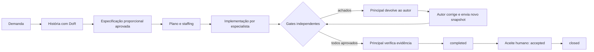

1. **Demanda → história.** O principal esclarece o objetivo e o `product-owner` escreve a história com critérios Given/When/Then. Só uma história que cumpre a **Definition of Ready** é despachada.
2. **Especificação e plano.** Uma especificação proporcional ao risco é aprovada; depois vêm o plano e o staffing (quem faz, quem consulta, quais gates, qual camada de modelo).
3. **Implementação.** Cada tarefa tem um dono e escopo de escrita disjunto. O brief leva objetivo, critérios, caminhos permitidos, snapshot, autorizações e evidência esperada.
4. **Gates.** QA, revisão técnica/conformidade, segurança (e privacidade, quando há dados pessoais) validam **o mesmo snapshot congelado**. Gates somente leitura podem rodar em paralelo; o QA roda por último.
5. **Correção.** Achados têm ID estável e voltam ao autor responsável; ninguém corrige em silêncio o que está aprovando.
6. **Verificação do principal.** Sem achados pendentes, com todos os veredictos explícitos, o principal **reexecuta ao menos um comando de evidência** e marca `completed`.
7. **Aceite.** O humano registra `accepted` (identidade, data, escopo, decisão); depois `closed` na revisão da sprint.

> [!NOTE]
> "Superpowers" (quando disponível) automatiza as fases; o quadro do GitHub Projects **registra** execução e aceite, não é um segundo motor de fluxo. O equivalente manual segue as mesmas etapas e registra explicitamente a automação ausente.

**Só no desenho:** "14 subgrafos" e "backpropagation loop" são rótulos do diagrama. Os nomes `tech-review`, `delivery`, `correction` são etapas, não agentes.

---

##  Etapa 01 · Instalação

[svg-01-instalacao.html](../assets/svg-01-instalacao.html)


**O que o diagrama mostra:** pré-requisitos → instalar → provedores → perfis → estrutura de pastas → validação.

**Regra real** ([README](../README.md), [scripts/template.py](../scripts/template.py)):

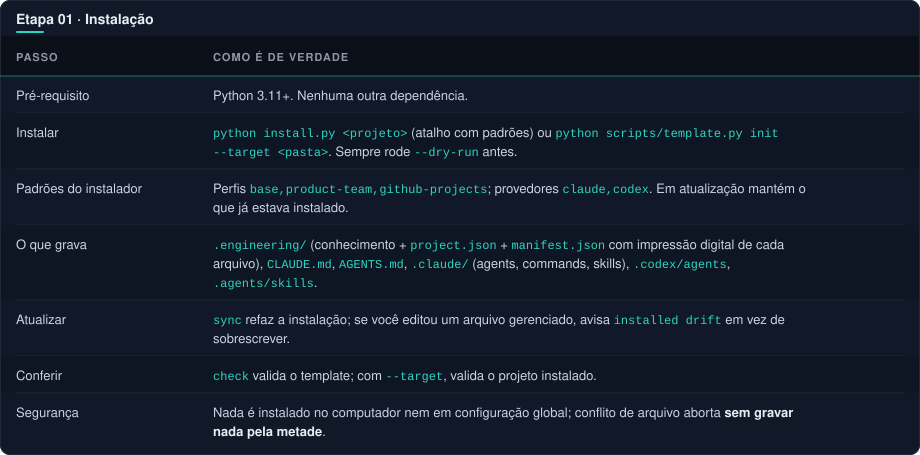

Ver como texto

| Passo | Como é de verdade |
|---|---|
| Pré-requisito | Python 3.11+. Nenhuma outra dependência. |
| Instalar | `python install.py <projeto>` (atalho com padrões) ou `python scripts/template.py init --target <pasta>`. Sempre rode `--dry-run` antes. |
| Padrões do instalador | Perfis `base,product-team,github-projects`; provedores `claude,codex`. Em atualização mantém o que já estava instalado. |
| O que grava | `.engineering/` (conhecimento + `project.json` + `manifest.json` com impressão digital de cada arquivo), `CLAUDE.md`, `AGENTS.md`, `.claude/` (agents, commands, skills), `.codex/agents`, `.agents/skills`. |
| Atualizar | `sync` refaz a instalação; se você editou um arquivo gerenciado, avisa `installed drift` em vez de sobrescrever. |
| Conferir | `check` valida o template; com `--target`, valida o projeto instalado. |
| Segurança | Nada é instalado no computador nem em configuração global; conflito de arquivo aborta **sem gravar nada pela metade**. |

**Só no desenho:** `pip install engineering-template`, exigência de Node.js, chaves `ANTHROPIC_API_KEY`/`OPENAI_API_KEY`, "wizard interativo", `config.yaml`, pastas `/agents` em YAML, `/worktrees`, `template.py validate` (o comando real é `check`), prioridade entre provedores com fallback, "budget por wave" e concorrência. Nada disso existe no template.

---

##  Etapa 02 · Perfis

[svg-02-perfis.html](../assets/svg-02-perfis.html)


**O que o diagrama mostra:** perfis empilhados sobre o `base`, ordem de resolução e perfis "adicionais".

**Regra real** ([profiles/](../profiles/), [README](../README.md#perfis)):

- Um perfil é um **pacote opcional de instruções** ligado na instalação com `--profiles a,b`. O `base` é sempre usado e não escolhe stack, nuvem, banco, framework nem hospedagem.
- São **10 perfis**: `base`, `github-projects`, `product-team`, `polyrepo`, `session-continuity`, `nestjs-mikroorm`, `python`, `aws-serverless`, `hosting-managed`, `vps-k3s`.
- **Conflito real:** `hosting-managed` e `vps-k3s` são alternativas entre si; não existe `--all`.
- Os **28 papéis são instalados com qualquer combinação** de perfis (o teste do template confirma 28 agentes só com `base`). O perfil muda as instruções e as regras que o projeto adota, não quantos especialistas existem.
- Escolher perfil não instala programa nenhum.

**Só no desenho:** os perfis `stacks`, `security`, `privacy`, `design`, `analytics`, `mobile`, `ai-ml`, `enterprise` e `custom`; a divisão "4/16/4/4 agentes"; a herança estilo YAML (`!override`, merge de listas); "requer: GitHub token".

---

##  Etapa 03 · Planejamento e brainstorm

[svg-03-brainstorm.html](../assets/svg-03-brainstorm.html)


**O que o diagrama mostra:** demanda bruta → principal → especialistas em paralelo (histórias e usabilidade) → síntese → aprovação humana.

**Regra real** ([engineering.md](../core/workflow/engineering.md), [staffing.md](../core/workflow/staffing.md), [usability.md](../core/workflow/usability.md)):

1. O principal **recebe e decompõe** o pedido, esclarece o objetivo e identifica domínio, stack e versões reais, risco, fase e artefatos afetados. Se algo é desconhecido, pergunta ao humano ou faz uma descoberta somente leitura.
2. Escolhe especialistas pelo domínio **comprovado**, não por "notas inventadas" nem um generalista para tudo. Lacuna vira proposta (adaptar, criar papel ou agente externo aprovado), nunca substituição silenciosa.
3. **Consulta não concede escrita.** Especialistas podem trocar consultas rastreáveis; trabalho novo passa pelo principal.
4. Quem escreve a história é o `product-owner`. Quando o fluxo é de usuário, o `ux-researcher` prepara personas e tarefas e **dois `lay-user`** (camada `light`) simulam pessoas leigas ([etapa 11](#etapa-11--design-ux-e-usuários-leigos)).
5. A aprovação humana separa o que está pronto do que volta para refinamento.

**Só no desenho:** `story-agent` e `usability-agent` (os papéis reais são `product-owner`, `ux-researcher`, `lay-user`); "score mínimo 7/10 dos lay-users" (o template classifica achados por severidade, não por nota); a lista de arquivos gerados (`product-brief.md`, `backlog-wave1.yaml`…); "orchestrator em tier deep/Opus" (o principal é a sessão do usuário, não um papel com camada).

---

##  Etapa 04 · Requisitos e histórias

[svg-04-requisitos.html](../assets/svg-04-requisitos.html)


**O que o diagrama mostra:** história S-NNN, critério INVEST, Given/When/Then, DoR e DoD, hierarquia e priorização.

**Regra real** ([user-stories.md](../core/workflow/user-stories.md), [templates/user-story.md](../core/templates/user-story.md)):

- **Hierarquia:** Épico (resultado) → História (comportamento visível, cabe em uma sprint) → Tarefa (trabalho de especialista). Histórias são sub-issues do épico; tarefas, sub-issues da história. Bugs e spikes têm tipo próprio.
- **Título** `[S-NNN] verbo + resultado`; o ID no título é a identidade, o número da issue é só o link.
- **Conteúdo:** narrativa (persona, objetivo, valor), regras de negócio (`BR-NNN`), critérios Given/When/Then testáveis (incluindo caminhos negativos, permissões e falhas), fluxo, requisitos não funcionais (WCAG 2.2 AA, segurança, privacidade, resiliência), ativos, metadados, fora de escopo e perguntas abertas com recomendação.
- **INVEST:** a história que falha uma letra é dividida, retrabalhada ou marcada `blocked`; **nunca despachada como está**.

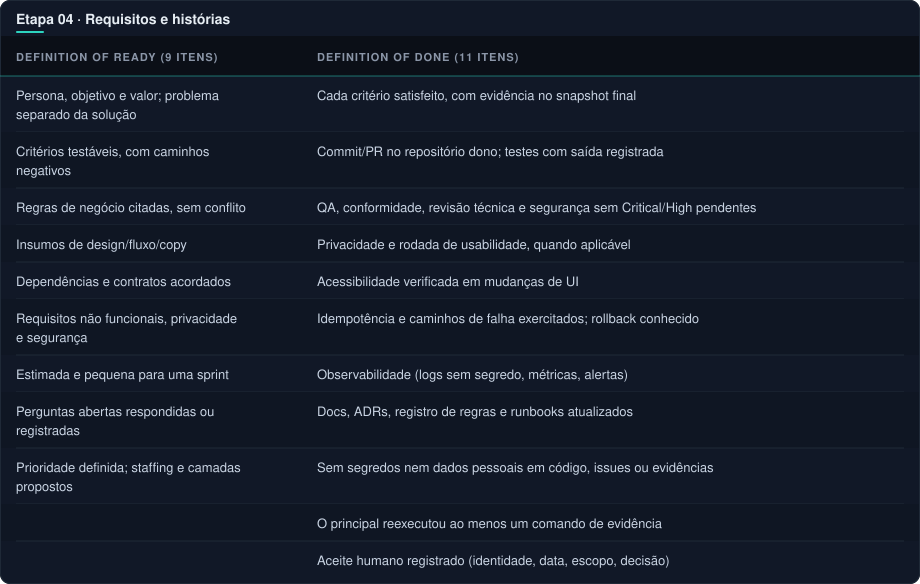

Ver como texto

| Definition of Ready (9 itens) | Definition of Done (11 itens) |
|---|---|
| Persona, objetivo e valor; problema separado da solução | Cada critério satisfeito, com evidência no snapshot final |
| Critérios testáveis, com caminhos negativos | Commit/PR no repositório dono; testes com saída registrada |
| Regras de negócio citadas, sem conflito | QA, conformidade, revisão técnica e segurança sem Critical/High pendentes |
| Insumos de design/fluxo/copy | Privacidade e rodada de usabilidade, quando aplicável |
| Dependências e contratos acordados | Acessibilidade verificada em mudanças de UI |
| Requisitos não funcionais, privacidade e segurança | Idempotência e caminhos de falha exercitados; rollback conhecido |
| Estimada e pequena para uma sprint | Observabilidade (logs sem segredo, métricas, alertas) |
| Perguntas abertas respondidas ou registradas | Docs, ADRs, registro de regras e runbooks atualizados |
| Prioridade definida; staffing e camadas propostos | Sem segredos nem dados pessoais em código, issues ou evidências |
| | O principal reexecutou ao menos um comando de evidência |
| | Aceite humano registrado (identidade, data, escopo, decisão) |

> [!NOTE]
> O principal só despacha com DoR cumprida e só marca `completed` depois do DoD. O DoR/DoD acima é o **padrão**; cada projeto pode estendê-lo.

**Só no desenho:** `story-agent`; DoD de **12** itens com "cobertura ≥ 80%", "PR merged" e "CI verde" (o DoD real tem 11, sem limiar de cobertura); prioridade MoSCoW e pontos em Fibonacci (o template pede pontos relativos ou tamanhos de camiseta, e a prioridade do quadro é `critical/high/medium/low`); "score 7/10 com lay-user".

---

##  Etapa 05 · Staffing

[svg-05-staffing.html](../assets/svg-05-staffing.html)


**O que o diagrama mostra:** tarefa recebida → principal analisa → seleção → brief por agente → execução paralela, com os especialistas em quatro grupos.

**Regra real** ([staffing.md](../core/workflow/staffing.md), [template.json](../template.json)):

Staffing é uma **decisão por tarefa, registrada no brief** (`templates/staffing.md`), não um elenco fixo. Sete passos: entender antes de escalar, selecionar, formar o time, escolher a camada do modelo, moldar o trabalho, executar e recuperar, fechar.

- **Um especialista por pergunta.** Outro só entra para domínio diferente, gate independente obrigatório ou segunda opinião justificada.
- **Os 28 papéis reais**, em 5 grupos:

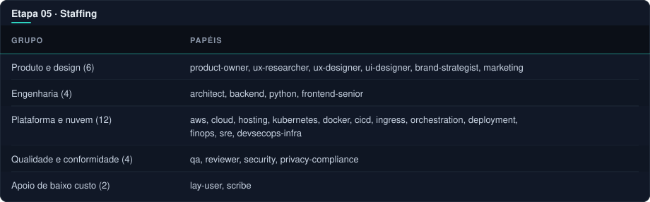

Ver como texto

| Grupo | Papéis |
|---|---|
| Produto e design (6) | product-owner, ux-researcher, ux-designer, ui-designer, brand-strategist, marketing |
| Engenharia (4) | architect, backend, python, frontend-senior |
| Plataforma e nuvem (12) | aws, cloud, hosting, kubernetes, docker, cicd, ingress, orchestration, deployment, finops, sre, devsecops-infra |
| Qualidade e conformidade (4) | qa, reviewer, security, privacy-compliance |
| Apoio de baixo custo (2) | lay-user, scribe |

- **Formas de time padrão** (ponto de partida; só se remove um gate com motivo registrado, e "para economizar tokens" não é motivo): capacidade nova de produto, mudança de backend/API, só UI, marca/marketing, infraestrutura, incidente, decisão de arquitetura, trabalho de backlog.
- **Fatiar em tarefas verticais** com um dono cada e escopos de escrita disjuntos; arquivos compartilhados (lockfile, migrações, config raiz, tokens de design, contratos) têm **um único dono**. Para muitos itens parecidos: contrato primeiro, depois construtores em paralelo, depois um dono de integração.
- **Recuperar:** sem atividade por ~10 minutos, inspecione pelo status autorizado, reenvie uma vez com brief mais afiado, depois substitua o especialista ou reporte `blocked`. Silêncio nunca aprova.
- **Fechar:** o principal verifica, registra o pós-mortem (o que funcionou, o que falhou, quais escolhas mudar) e entrega riscos abertos ao humano **com uma recomendação**.

**Só no desenho:** os nomes `backend-agent`, `database-agent`, `owasp-agent`, `lgpd-agent`, `observability-agent` etc.; os grupos A/B/C/D com 8/6/7/7 agentes (não somam os 28 reais); "só ativa os necessários" como etapa própria.

---

##  Etapa 06 · Camadas de modelo

[svg-06-tiers.html](../assets/svg-06-tiers.html)


**O que o diagrama mostra:** `deep`, `standard`, `light`, árvore de decisão e 12 regras de economia.

**Regra real** ([models.md](../core/policies/models.md), [economy.md](../core/workflow/economy.md)):


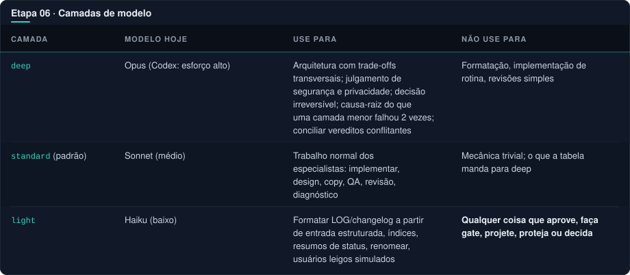

Ver como texto

| Camada | Modelo hoje | Use para | Não use para |
|---|---|---|---|
| `deep` | Opus (Codex: esforço alto) | Arquitetura com trade-offs transversais; julgamento de segurança e privacidade; decisão irreversível; causa-raiz do que uma camada menor falhou 2 vezes; conciliar vereditos conflitantes | Formatação, implementação de rotina, revisões simples |
| `standard` (padrão) | Sonnet (médio) | Trabalho normal dos especialistas: implementar, design, copy, QA, revisão, diagnóstico | Mecânica trivial; o que a tabela manda para deep |
| `light` | Haiku (baixo) | Formatar LOG/changelog a partir de entrada estruturada, índices, resumos de status, renomear, usuários leigos simulados | **Qualquer coisa que aprove, faça gate, projete, proteja ou decida** |

**Cinco sinais, em ordem, para escolher por despacho** (registre `Model: <camada> - <motivo>` no brief): (1) raio de impacto, (2) novidade e ambiguidade, (3) tamanho do contexto, (4) falha anterior, (5) custo de errar × custo da camada.

- **Subir:** `light → standard` após duas falhas ou necessidade de julgar; `standard → deep` por sinais de risco, papel de gate no caminho crítico ou vereditos contestados. **Descer:** depois que a decisão difícil virou especificação/ADR, a execução volta para camadas baratas.
- **Independência é por instância, snapshot e função, não só por camada.** Em mudanças de alto risco, prefira validador de camada ou provedor diferente do autor. **Nenhum gate fica abaixo de `standard`.**
- Um projeto pode mudar a camada de um papel com `--tier papel=camada` (fica em `.engineering/project.json`); isso **nunca** rebaixa um gate abaixo de `standard`.

**As 12 regras de economia reais** ([economy.md](../core/workflow/economy.md)): (1) um autor por vez, (2) brief por referência (≤ ~15 linhas), (3) handoff em arquivo (≤ 40 linhas, em `docs/operations/handoffs/`), (4) não retomar agente pesado (~150k tokens), (5) escopo antes da suíte completa, (6) evidência pesada só no final, (7) gates uma vez por snapshot, (8) camadas por função, (9) relatórios enxutos, (10) contexto do principal pequeno, (11) conferência de orçamento por onda (dividir tarefa acima de ~250k), (12) registros baratos por append direto.

**Só no desenho:** os percentuais de custo (100%, ~20-25%, ~1-3%), os tetos "40/50/10% por onda", "orchestrator sempre deep", "light para changelog do `tech-writer`" e as 12 regras do desenho (que são outras: prompts concisos, cache, chunking…). As regras reais são as listadas acima.

---

##  Etapa 07 · Execução e worktrees

[svg-07-worktrees.html](../assets/svg-07-worktrees.html)


**O que o diagrama mostra:** tarefa despachada → worktree → implementação → handoff → pull request, com vários worktrees em paralelo.

**Regra real:**

- **O brief de cada despacho** leva: objetivo, função/instância, critérios, caminhos da spec/plano, snapshot/base, caminhos permitidos de leitura e escrita, exclusões, dependências, decisões, autorizações e evidência esperada. Passa-se **caminhos e contexto focado**, nunca históricos inteiros ([engineering.md](../core/workflow/engineering.md)).
- **Um autor por vez.** Dois só em paralelo quando os escopos de escrita são **disjuntos** e cada um tem contexto pequeno ([economy.md](../core/workflow/economy.md), regra 1).
- **Handoff em arquivo:** ao terminar, o agente escreve ≤ 40 linhas (arquivos tocados, IDs, comandos e resultados, pendências) em `docs/operations/handoffs/<tarefa>-<data>.md` e devolve ao principal só o caminho e 5 a 10 linhas. Reexecutar sobrescreve o próprio handoff (idempotência).
- **Agente cortado ou silencioso é falha a tratar**, não conclusão: reenvie uma vez, depois substitua.
- O instalador sugere `worktree.baseRef=head` em [integrations/claude/settings.json](../integrations/claude/settings.json), para que worktrees partam do commit atual.

> [!NOTE]
> O isolamento por worktree é uma **prática recomendada de execução**, não uma regra do `core/`. As regras obrigatórias são escopos disjuntos, dono único de arquivos compartilhados e um snapshot reprodutível por gate.

**Só no desenho:** nomes de branch (`feat/backend-S-042`), "cobertura 80%", padrões de nomenclatura por linguagem, commit com `Refs: S-042`, "PR com 4-eyes aprovado" e remoção automática do worktree.

---

##  Etapa 08 · Gates independentes

[svg-08-gates.html](../assets/svg-08-gates.html)


**O que o diagrama mostra:** o handoff vai a três gates em paralelo (revisão técnica, segurança, privacidade); o QA agrega; aprovado segue para PR, rejeitado volta com causa.

**Regra real** ([engineering.md](../core/workflow/engineering.md), [economy.md](../core/workflow/economy.md), [evidence.md](../core/policies/evidence.md)):

1. **O autor entrega** artefatos e evidência "prontos para validação", nunca autoaprovados.
2. **Congela-se um snapshot completo e reprodutível** (inclui arquivos não rastreados; `git diff` puro não basta) e uma base de comparação. **Todos os validadores inspecionam a mesma entrada.**
3. **Gates somente leitura** (revisão técnica, segurança, privacidade) podem rodar em paralelo; **o QA roda por último**. Paralelo só com caminhos de saída sem conflito.
4. **Cada validador designado devolve um veredito explícito e delimitado.** Nenhum gate substitui outro.
5. **Veredito é por gate e por snapshot.** Qualquer mudança depois da aprovação exige análise de impacto e nova validação dos gates afetados; um SHA antigo nunca aprova a árvore nova.

**Matriz de validação independente** (resumo; completa em [engineering.md](../core/workflow/engineering.md)):

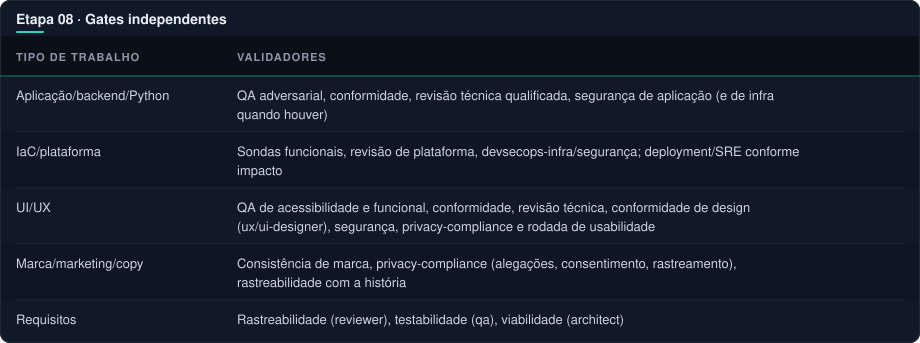

Ver como texto

| Tipo de trabalho | Validadores |
|---|---|
| Aplicação/backend/Python | QA adversarial, conformidade, revisão técnica qualificada, segurança de aplicação (e de infra quando houver) |
| IaC/plataforma | Sondas funcionais, revisão de plataforma, devsecops-infra/segurança; deployment/SRE conforme impacto |
| UI/UX | QA de acessibilidade e funcional, conformidade, revisão técnica, conformidade de design (ux/ui-designer), segurança, privacy-compliance e rodada de usabilidade |
| Marca/marketing/copy | Consistência de marca, privacy-compliance (alegações, consentimento, rastreamento), rastreabilidade com a história |
| Requisitos | Rastreabilidade (reviewer), testabilidade (qa), viabilidade (architect) |

**Só no desenho:** "QA-GATE agrega os 3 relatórios" (na regra real o principal consolida; o QA é um gate independente), "cobertura ≥ 80%" e os exemplos `backend-agent → qa-agent`.

---

##  Etapa 09 · Ciclo de correção

[svg-09-retro.html](../assets/svg-09-retro.html)


**O que o diagrama mostra:** gate rejeita → causa documentada → novo agente → revalidação, com escalonamento por tentativa.

**Regra real** ([engineering.md](../core/workflow/engineering.md), seção "Correction and convergence"):

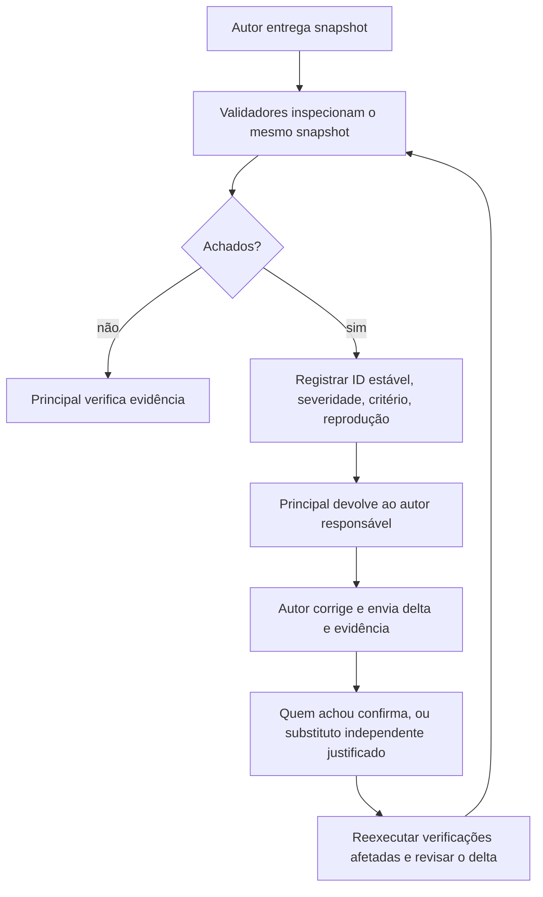

- **Cada achado** tem ID estável, severidade, critério, localização, reprodução, autor, responsável pela correção e condição de resolução. Duplicados são consolidados sem perder a autoria.
- **Revisores nunca corrigem em silêncio** o que estão aprovando. Divergência exige prova; o autor **não fecha** o achado sozinho.
- **Duas rodadas consecutivas com a mesma falha**, ou um impasse técnico, disparam **diagnóstico de causa-raiz ou um terceiro especialista independente**. Esse gatilho é configurável e **nunca limita a qualidade nem encerra a tarefa por contagem de rodadas.**
- Mantenha os IDs, revise só o delta, reaproveite evidência válida e **não reinicie agentes irrelevantes**.
- Depois de duas falhas na mesma frente, a camada sobe de nível por evidência ([etapa 06](#etapa-06--camadas-de-modelo)).
- **Mapeamento de severidade:** Critical/High/Medium/Low. **Critical e High bloqueiam `completed`** até corrigidos e revalidados, ou até uma decisão de risco explicitamente autorizada ([github-projects.md](../core/workflow/github-projects.md)).

**Só no desenho:** "máx. 3 tentativas", "3ª tentativa deep obrigatória", "4ª+ intervenção humana", "issue bloqueada após 3". O template não define teto de tentativas; usa o gatilho de duas rodadas acima.

---

##  Etapa 10 · LGPD/GDPR

[svg-10-lgpd.html](../assets/svg-10-lgpd.html)


**O que o diagrama mostra:** dado pessoal detectado → base legal → finalidade → retenção → gate de privacidade, com os princípios da LGPD/GDPR.

**Regra real:**

- O papel é o `privacy-compliance` (camada `deep`). É **consultado já no DoR** quando a história envolve dado pessoal ou de saúde, consentimento, pagamento ou rastreamento ([user-stories.md](../core/workflow/user-stories.md)).
- É **gate obrigatório** em UI/UX, marca/marketing/copy (alegações, consentimento, rastreamento) e onde houver dados pessoais ([engineering.md](../core/workflow/engineering.md)).
- A **precedência de decisão** coloca saúde e segurança do usuário, leis de privacidade (LGPD, GDPR) e de consumo **acima** de regras de negócio, usabilidade, copy e preferência. Pontos que exigem advogado ficam marcados `[LEGAL-REVIEW]` e vão ao humano: **não saem na palavra de um agente** ([usability.md](../core/workflow/usability.md)).
- Dados pessoais e de saúde nunca ficam em rascunhos, URLs, logs nem analytics "por conveniência"; diário e estado vivo guardam só tipos de evento, horários, status e caminhos.

> [!WARNING]
> Os artigos de lei, prazos (por exemplo "DSAR em 15 dias") e exemplos de código do diagrama são **referência didática**, não parecer jurídico. Valide com advogado antes de aplicar.

---

##  Etapa 11 · Design, UX e usuários leigos

[svg-11-ux.html](../assets/svg-11-ux.html)


**O que o diagrama mostra:** requisito de tela → UX/IA → marca e design system → acessibilidade → teste rápido com persona leiga.

**Regra real** ([usability.md](../core/workflow/usability.md)):

**Elenco:** o principal (processo e decisões), o `ux-researcher` (planeja, modera, tria), **exatamente dois `lay-user`** (camada `light`, personas diferentes, sem conhecimento técnico, somente leitura) e os participantes do brainstorm: ux-designer, ui-designer, brand-strategist, product-owner, privacy-compliance, o especialista implementador e, quando preciso, security, qa e marketing.

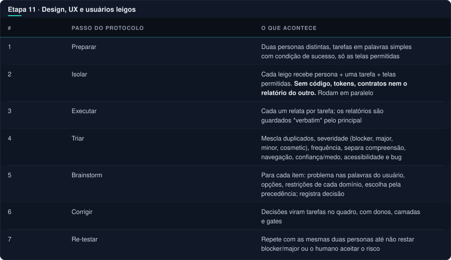

Ver como texto

| # | Passo do protocolo | O que acontece |
|---|---|---|
| 1 | Preparar | Duas personas distintas, tarefas em palavras simples com condição de sucesso, só as telas permitidas |
| 2 | Isolar | Cada leigo recebe persona + uma tarefa + telas permitidas. **Sem código, tokens, contratos nem o relatório do outro.** Rodam em paralelo |
| 3 | Executar | Cada um relata por tarefa; os relatórios são guardados *verbatim* pelo principal |
| 4 | Triar | Mescla duplicados, severidade (blocker, major, minor, cosmetic), frequência, separa compreensão, navegação, confiança/medo, acessibilidade e bug |
| 5 | Brainstorm | Para cada item: problema nas palavras do usuário, opções, restrições de cada domínio, escolha pela precedência; registra decisão |
| 6 | Corrigir | Decisões viram tarefas no quadro, com donos, camadas e gates |
| 7 | Re-testar | Repete com as mesmas duas personas até não restar blocker/major ou o humano aceitar o risco |

**Precedência (decide conflitos):** 1) segurança e saúde, leis de privacidade e de consumo → 2) regras de negócio cruciais → 3) usabilidade e acessibilidade → 4) copy e marca → 5) preferência. Uma melhoria que viola 1 ou 2 perde.

**Salvaguardas:** sem dark patterns (consentimento pré-marcado, saída escondida, urgência falsa); nunca trocar clareza de consentimento, minimização de dados, facilidade de cancelar ou transparência de preço por conversão; produtos de saúde sem culpa nem pressão de sequência. Usuários simulados são um **proxy barato, não substituem usuários reais** em fluxos de risco.

**Só no desenho:** `ux-agent`, `accessibility-agent`, `copywriting-agent`, `design-system-agent`, `ia-agent` (não são papéis; acessibilidade é critério de QA e de história, WCAG 2.2 AA) e a nota "score ≥ 7/10".

---

##  Etapa 12 · Infra e CI/CD

[svg-12-infra.html](../assets/svg-12-infra.html)


**O que o diagrama mostra:** push → build → teste → varredura de segurança → deploy → observabilidade, com o grupo de especialistas de plataforma.

**Regra real** ([template.json](../template.json), [safety.md](../core/policies/safety.md), [engineering.md](../core/workflow/engineering.md)):

- **Papéis de plataforma (12):** `aws`, `cloud`, `hosting`, `kubernetes`, `docker`, `cicd`, `ingress`, `orchestration` (aqui significa *service mesh*, **não** o coordenador), `deployment`, `finops`, `sre`, `devsecops-infra`. Cada um tem **descrição de quando usar**, modo (por exemplo implementador ou diagnóstico) e camada; `cloud` e `devsecops-infra` são `deep`.
- **`aws` é implementador** (SAM/Terraform); `cloud` **decide quais serviços e por quê**; `devsecops-infra` cobre só a camada de **infraestrutura** (o código de aplicação é do `security`).
- **Validação de IaC/plataforma:** sondas funcionais, revisão de plataforma, devsecops-infra/segurança; deployment/SRE conforme o impacto. CI/CD: gates e rollback testados, revisão de conformidade, segurança e SRE quando há impacto operacional.
- **Irreversível exige autorização explícita:** deploy em produção, migração em produção, mudança de IAM, operação destrutiva, rotação de segredo. Prepara-se **proposta concreta e revisável** primeiro; o trabalho não afetado continua.
- **Ferramentas externas** (scanners, observabilidade) só entram por proposta aprovada e registro ([installations.md](../core/policies/installations.md)).

**Só no desenho:** `observability-agent`, Trivy, Snyk, Checkov, OPA, Prometheus, Loki, PagerDuty, Grafana, Vercel/Fly.io/Railway, "cobertura ≥ 80% bloqueia" e "rollback automático". São exemplos; o template **não instala** nenhuma dessas ferramentas.

---

##  Etapa 13 · GitHub Projects

[svg-13-tracker.html](../assets/svg-13-tracker.html)


**O que o diagrama mostra:** quadro com colunas, campos do projeto, log de eventos e issues de decisão.

> [!WARNING]
> **Este é o diagrama que mais diverge do contrato.** As colunas desenhadas (Backlog, Ready, In Progress, In Review, QA, Em Decisão, Bloqueado, Done, Cancelado) e as prioridades `P0–P3` **não são** as do template. Use a tabela abaixo.

**Regra real** ([github-projects.md](../core/workflow/github-projects.md), [profiles/github-projects.json](../profiles/github-projects.json)):

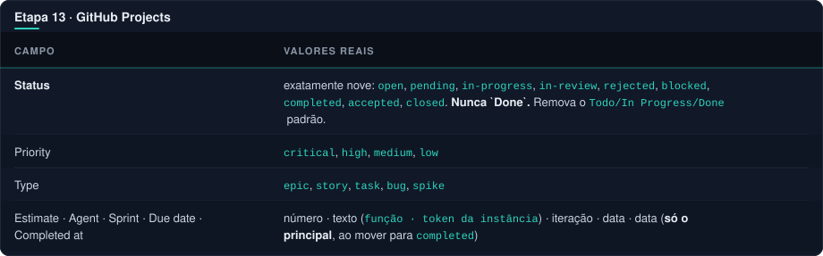

Ver como texto

| Campo | Valores reais |
|---|---|
| **Status** | exatamente nove: `open`, `pending`, `in-progress`, `in-review`, `rejected`, `blocked`, `completed`, `accepted`, `closed`. **Nunca `Done`.** Remova o `Todo/In Progress/Done` padrão. |
| Priority | `critical`, `high`, `medium`, `low` |
| Type | `epic`, `story`, `task`, `bug`, `spike` |
| Estimate · Agent · Sprint · Due date · Completed at | número · texto (`função · token da instância`) · iteração · data · data (**só o principal**, ao mover para `completed`) |

**Frescor e dupla validação** (regra nova, valores padrão que cada projeto pode mudar):

| Item | Regra |
|---|---|
| Card parado | Sem mudança de Status, comentário, evidência ou LOG: 24 h em `in-progress`/`in-review`, 7 dias em `pending`/`blocked`, 30 dias em `open` |
| Dono da demanda | `product-owner` (ou o principal) confirma que o pedido continua vivo, com prioridade e critérios atuais; senão reescreve ou fecha com motivo |
| Dono da entrega | O especialista atribuído confirma que Status, evidência e próximo dono refletem o trabalho real |
| Conferência independente | O principal cruza as duas confirmações com histórico, handoffs e evidências, e registra as irregularidades |
| Revisão a cada registro | Ao gravar handoff, diário ou estado vivo, o principal revisa o quadro na mesma hora: agente perdido tira o card de `in-progress` |

**Quem muda cada estado:**

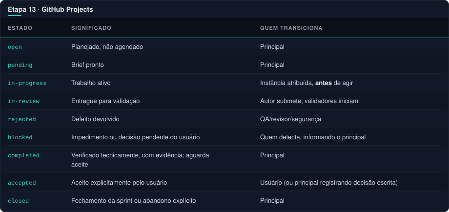

Ver como texto

| Estado | Significado | Quem transiciona |
|---|---|---|
| `open` | Planejado, não agendado | Principal |
| `pending` | Brief pronto | Principal |
| `in-progress` | Trabalho ativo | Instância atribuída, **antes** de agir |
| `in-review` | Entregue para validação | Autor submete; validadores iniciam |
| `rejected` | Defeito devolvido | QA/revisor/segurança |
| `blocked` | Impedimento ou decisão pendente do usuário | Quem detecta, informando o principal |
| `completed` | Verificado tecnicamente, com evidência; aguarda aceite | Principal |
| `accepted` | Aceito explicitamente pelo usuário | Usuário (ou principal registrando decisão escrita) |
| `closed` | Fechamento da sprint ou abandono explícito | Principal |

- **Workflows automáticos do GitHub que mudam Status ficam desligados:** o status segue a tabela de autoridade, não eventos do repositório. O especialista **nunca** promove a própria issue além de `in-review`. O GitHub não impede quem move o card, então o principal **audita** o histórico do Projeto na verificação.
- **IDs:** `task-N`, `task-N-impl`, `task-N-review`, `task-N-qa`, `task-N-security`, `task-N-fix`; histórias `[S-NNN]`, épicos `[E-NN]`. Labels `role:*`, `type:*`, `tier:*`, `task-N`, `checkpoint`.
- **Log de eventos:** comentários na issue pai, um evento por comentário, no formato `LOG <TIPO> | <UTC> | <instância> | <issue> | <mensagem> | <link de evidência>`. Tipos: INICIO, MARCO, RED, GREEN, ESCOLHA, DESVIO, RISCO, PROBLEMA, SOLUCAO, DECISAO, **ALERTA_PERIGO**, FIM.
- **Decisão do usuário:** `blocked` com prefixo `DECISAO` no título, estado anterior no corpo, contexto, opções, recomendação e consequência se ninguém responder; o trabalho não afetado continua.
- **Agentes somente leitura** devolvem atualizações completas ao principal, que as persiste fielmente; persistir **não transfere autoria nem aprovação**. Se o quadro não pode ser escrito, o card fica com o principal como pendência e a lacuna vira `blocked`, sem recorrer silenciosamente a outro tracker.

---

##  Etapa 14 · Continuidade de sessão

[svg-14-tokens.html](../assets/svg-14-tokens.html)


**O que o diagrama mostra:** marcos de tokens (100k, 200k, 300k, 400k), arquivo de estado vivo e recuperação após queda.

**Regra real** ([session-continuity.md](../core/workflow/session-continuity.md)) — vale **só com o perfil `session-continuity`** (opt-in):

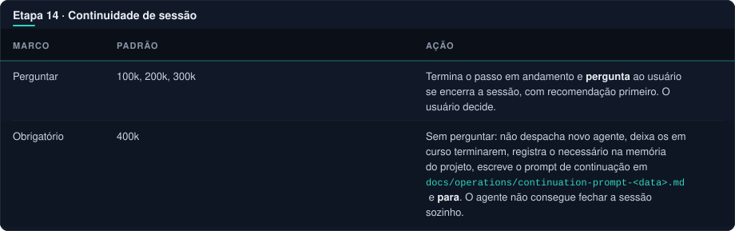

Ver como texto

| Marco | Padrão | Ação |
|---|---|---|
| Perguntar | 100k, 200k, 300k | Termina o passo em andamento e **pergunta** ao usuário se encerra a sessão, com recomendação primeiro. O usuário decide. |
| Obrigatório | 400k | Sem perguntar: não despacha novo agente, deixa os em curso terminarem, registra o necessário na memória do projeto, escreve o prompt de continuação em `docs/operations/continuation-prompt-<data>.md` e **para**. O agente não consegue fechar a sessão sozinho. |

Os limiares são configuráveis por projeto. Orçamento esgotado **nunca** é aprovação de gate pendente. O contador automático é só uma [especificação não verificada](../integrations/token-milestones/README.md).

**Artefatos de retomada** (para queda de máquina ou conexão):

- **Diário de eventos (só acréscimo)** `docs/operations/session-diary-<data>.md`: uma linha curta por ponto fixo (antes de despachar, ao chegar relatório, ao abrir/fechar gate). Uma queda perde no máximo a última linha.
- **Estado vivo (curto, sobrescrito)** `docs/operations/live-state.md`, no máximo 25 linhas, atualizado por arquivo temporário + renomeação (substituição atômica).
- **Memória do projeto só nos marcos**, para economizar tokens; registros mecânicos por `echo >>`, sem agente.

**Revisão do quadro:** cada entrada de diário e cada atualização do estado vivo é seguida da revisão do quadro ([etapa 13](#etapa-13--github-projects)); um agente dado por perdido não pode deixar o card `in-progress`.

**Retomar após queda:** (1) ler `live-state.md` e o fim do diário; (2) **um agente que estava em andamento é dado por PERDIDO**; (3) se o handoff existe, continuar dele, senão despachar **novo** agente com tarefa fechada, **nunca retomar o antigo**; (4) revalidar o hash do snapshot antes de confiar em veredito anterior; (5) acrescentar ao diário o que foi achado.

> [!NOTE]
> Diário e estado vivo guardam só tipos de evento, horários, status e caminhos relativos. **Nunca** texto de prompt, saída de ferramenta, segredos ou dados pessoais.

**Só no desenho:** "100k = checkpoint com commit", "300k = wrapper compacta", `live-state.md` na raiz, o exemplo de conteúdo com datas e stack, e "recuperação em < 3 min".

---

##  Etapa 15 · Segurança

[svg-15-security.html](../assets/svg-15-security.html)


**O que o diagrama mostra:** código novo → varredura estática, de segredos e checklist OWASP → resultado (aprovado, revisão, ALERTA_PERIGO) e o protocolo de alerta.

**Regra real** ([safety.md](../core/policies/safety.md), [evidence.md](../core/policies/evidence.md), [github-projects.md](../core/workflow/github-projects.md)):

- **Dois papéis, duas camadas:** `security` cuida da aplicação (autenticação, autorização, injeção, IDOR); `devsecops-infra` cuida de IaC (configuração insegura, segredos em IaC, IAM). Ambos `deep`.
- **Segredos:** nunca registrar nem commitar tokens, senhas, chaves, estado ou credenciais; sanitizar evidência preservando o que mostra falha ou cobertura; evitar comandos que despejam variáveis ou segredos descriptografados.
- **Varredura de segredos mostra onde, nunca o quê:** a busca usa só saída de lista de arquivos ou contagem (Grep `files_with_matches`/`count`; `rg -l`/`rg -c`, `grep -rl`), nunca saída de conteúdo, linha ou contexto (`output_mode: content`, `-n`, `-A/-B/-C`), para que o valor encontrado não entre na conversa. O relato traz caminho, tipo de padrão e contagem. Para confirmar um achado, mascara-se o valor (prefixo curto ou só o nome da chave); ler a linha ou o arquivo inteiro exige autorização explícita do usuário para aquele arquivo, e o valor nunca é copiado para brief, log ou commit. Regras de ignore (`.gitignore`) escondem arquivos como `.env` da busca: o relato avisa, e ampliar a busca (`--no-ignore`) só vale dentro dos caminhos de leitura autorizados.
- **Moeda de confiança:** autenticação não é autorização; nunca confiar em identidade de dono/time enviada pelo cliente; menor privilégio.
- **Severidade:** Critical/High/Medium/Low, preservando a severidade da fonte. **Critical e High bloqueiam `completed`.** Rebaixar sem justificativa é proibido.
- **Ação antiética ou danosa não é executada.** Registra-se `CRITICIDADE ALTA/CRITICA` (ação, risco concreto, avaliação), **notifica-se o principal imediatamente**, e o principal avisa o usuário e registra `ALERTA_PERIGO` no log. Um risco hipotético sem explicação não é motivo para bloquear trabalho de rotina autorizado.
- **Decisão humana:** o item fica `blocked` com prefixo `DECISAO`; trabalho não afetado continua.

**Só no desenho:** Semgrep, CodeQL, Gitleaks, TruffleHog; "CVSS ≥ 9.0 / 7.0–8.9"; "agente para imediatamente — nenhuma ação adicional". O template não instala scanners e define severidade por Critical/High/Medium/Low, não por faixa de CVSS.

---

##  Etapa 16 · Métodos ágeis e Git

[svg-16-agile.html](../assets/svg-16-agile.html)


**O que o diagrama mostra:** ciclo Scrum de duas semanas, hierarquia de issues, worktrees, estrutura polyrepo e conventional commits.

**Regra real:**

- **Hierarquia:** épico → história → tarefa, com bug e spike como tipos próprios ([user-stories.md](../core/workflow/user-stories.md)). **Sprint** é o campo de iteração do Projeto; o fechamento (`closed`) acontece na **Sprint Review** ou por abandono explícito com label e motivo.
- **Estimativa:** pontos relativos (ou tamanhos de camiseta), reestimar quando o escopo muda; **limite de trabalho em andamento**: não iniciar história que não cabe no staffing e nos gates atuais.
- **Polyrepo** ([polyrepo.md](../core/workflow/polyrepo.md), perfil `polyrepo`): um **repositório hub sem código de aplicação** guarda requisitos, ADRs, specs, planos, sprints, runbooks, registro de instalações e decisões; **tarefas ficam em cada repositório de código** e voltam ao hub por link; **contratos e pacotes compartilhados saem antes dos consumidores**; a história do hub só é `completed` quando todas as tarefas estão verificadas **e** o comportamento entre repositórios foi provado por um teste de integração ou ponta a ponta. A ordem de release segue as dependências (pacotes → serviços → web → valores de infra).

**Versionamento (regra):** toda mudança que entra na `main` recebe antes uma tag SemVer, criada pelo principal sobre o commit verificado e publicada antes do código ([versioning.md](../core/policies/versioning.md)).

**Só no desenho:** a cerimônia Scrum detalhada (daily, retrospectiva com velocity), `git worktree add ../worktrees/agent-S-042`, a estrutura `~/projects/…` e a tabela de conventional commits com "gera release?". São convenções úteis, **não regras do template**.

---

##  Etapa 17 · Orquestração

[svg-17-orchestration.html](../assets/svg-17-orchestration.html)


**O que o diagrama mostra:** o orquestrador no topo, a regra cardinal, as regras de despacho e os especialistas em quatro grupos, fechando o ciclo de vida de uma tarefa.

**Regra real** ([engineering.md](../core/workflow/engineering.md), [staffing.md](../core/workflow/staffing.md), [safety.md](../core/policies/safety.md)):

> [!IMPORTANT]
> **Regra cardinal:** o principal **nunca** implementa nem emite parecer especializado. Ele pode manter briefs, issues e decisões e rodar verificações de evidência. Se a capacidade de subagentes está indisponível, coordene sessões especialistas independentes e verificadas ou registre o impedimento; o principal **não assume** implementação.

**Regras de despacho reais:**

1. Antes de despachar: domínio, stack e versão reais, risco, fase, artefatos afetados. Filtrar expertise incompatível.
2. O despacho leva o brief completo ([etapa 07](#etapa-07--execução-e-worktrees)), por caminhos, com camada `Model: <camada> - <motivo>`.
3. **Escopos de escrita disjuntos; dono único** de arquivos compartilhados.
4. Trabalho, agente ou escopo novos **passam pelo principal**; especialistas qualificados podem consultar uns aos outros de forma rastreável.
5. **Consulta não dá escrita.** Revisores nunca corrigem em silêncio; o QA pode escrever testes autorizados, não correções de produção.
6. Depois da entrega: gates independentes ([etapa 08](#etapa-08--gates-independentes)), correção ([etapa 09](#etapa-09--ciclo-de-correção)), verificação do principal, aceite humano.
7. Conflito entre especialistas: decide-se pela **precedência** (segurança/saúde/lei → regras de negócio → usabilidade → copy → preferência) e, em dúvida real de valor, **escala-se ao humano com recomendação**.

**Comunicação com o humano** ([communication.md](../core/policies/communication.md)): todo ID/sigla traz link para arquivo e linha (buscar antes de citar; se não achar, escrever "no link: not found"); nome por extenso na primeira menção; uma frase em linguagem simples para o que foge do comum; **toda pergunta que exige decisão traz opções com recomendação** (a recomendação nunca conta como aprovação).

**Só no desenho:** os nomes de agentes e os grupos com 9/8/7/8 agentes ("28 + orquestrador"), `orchestrator-agent` em Opus, "violação → parar sessão e abrir issue DECISAO" e o paralelismo "= recursos de contexto disponíveis". Os 28 papéis reais estão na [etapa 05](#etapa-05--staffing).

---

## Extra · Fluxo de embedding

[svg-embedding-flow.html](../assets/svg-embedding-flow.html)


Exemplo avulso de como um texto vira vetor e é buscado em um banco vetorial. **Não faz parte do template** e não ilustra nenhuma regra dos agentes.

---

## Mapa diagrama → arquivos de origem

| Diagrama | Leia as regras em |
|---|---|
| Macro | [engineering.md](../core/workflow/engineering.md), [economy.md](../core/workflow/economy.md) |
| 01 Instalação | [README](../README.md#começar), [scripts/template.py](../scripts/template.py), [docs/validation.md](validation.md) |
| 02 Perfis | [profiles/](../profiles/), [README](../README.md#perfis) |
| 03 Brainstorm | [staffing.md](../core/workflow/staffing.md), [engineering.md](../core/workflow/engineering.md) |
| 04 Requisitos | [user-stories.md](../core/workflow/user-stories.md), [templates/user-story.md](../core/templates/user-story.md) |
| 05 Staffing | [staffing.md](../core/workflow/staffing.md), [template.json](../template.json) |
| 06 Camadas | [models.md](../core/policies/models.md), [economy.md](../core/workflow/economy.md) |
| 07 Execução | [engineering.md](../core/workflow/engineering.md), [economy.md](../core/workflow/economy.md), [templates/brief.md](../core/templates/brief.md) |
| 08 Gates | [engineering.md](../core/workflow/engineering.md), [evidence.md](../core/policies/evidence.md) |
| 09 Correção | [engineering.md](../core/workflow/engineering.md) (Correction and convergence) |
| 10 LGPD/GDPR | [privacy-compliance.md](../core/roles/privacy-compliance.md), [usability.md](../core/workflow/usability.md) |
| 11 UX | [usability.md](../core/workflow/usability.md), [roles/](../core/roles/) |
| 12 Infra | [template.json](../template.json), [safety.md](../core/policies/safety.md), [installations.md](../core/policies/installations.md) |
| 13 Tracker | [github-projects.md](../core/workflow/github-projects.md), [integrations/github-projects](../integrations/github-projects/README.md) |
| 14 Sessão | [session-continuity.md](../core/workflow/session-continuity.md) |
| 15 Segurança | [safety.md](../core/policies/safety.md), [security.md](../core/roles/security.md), [devsecops-infra.md](../core/roles/devsecops-infra.md) |
| 16 Ágil e Git | [user-stories.md](../core/workflow/user-stories.md), [polyrepo.md](../core/workflow/polyrepo.md), [versioning.md](../core/policies/versioning.md) |
| 17 Orquestração | [engineering.md](../core/workflow/engineering.md), [communication.md](../core/policies/communication.md) |

Para criar novos diagramas no mesmo estilo, use a skill [`dark-pipeline-svg`](../core/skills/dark-pipeline-svg/SKILL.md).
