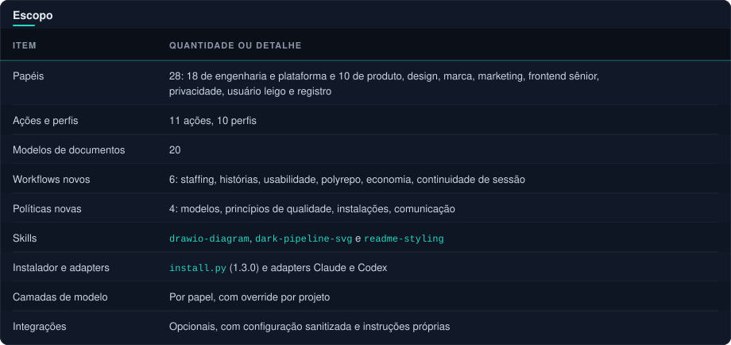

#  Validação da entrega

  
  
  
  
  

[← Voltar ao README](../README.md#sumario) · [Compatibilidade](compatibility.md) · [Guia dos diagramas](diagramas.md)

##  Escopo

Ver como texto

| Item | Quantidade ou detalhe |
|---|---|
| Papéis | 28: 18 de engenharia e plataforma e 10 de produto, design, marca, marketing, frontend sênior, privacidade, usuário leigo e registro |
| Ações e perfis | 11 ações, 10 perfis |
| Modelos de documentos | 20 |
| Workflows novos | 6: staffing, histórias, usabilidade, polyrepo, economia, continuidade de sessão |
| Políticas novas | 4: modelos, princípios de qualidade, instalações, comunicação |
| Skills | `drawio-diagram`, `dark-pipeline-svg` e `readme-styling` |
| Instalador e adapters | `install.py` (1.3.0) e adapters Claude e Codex |
| Camadas de modelo | Por papel, com override por projeto |
| Integrações | Opcionais, com configuração sanitizada e instruções próprias |

A versão 1.2.0 acrescentou economia, continuidade de sessão e comunicação (texto de contrato; ver [Limites](#limites)).

> [!NOTE]
> As skills de diagrama e README e o guia [diagramas.md](diagramas.md) (versão não lançada) são verificados só por presença e pelo teste de neutralidade. Os scripts das skills não têm testes automatizados.

##  Evidências executadas

- **CLI:** `check`, `doctor`, `init`, `sync` e `package` exercitados em fixtures locais.
- **Suíte Python** (`python -m unittest discover -s tests`): 34 testes, 1 ignorado (um teste de symlink ignorado por privilégio Windows); proteção contra junction validada. Novos testes cobrem camadas de modelo por papel, overrides validados e persistidos no manifesto, papéis de produto e UX (ferramentas e sandbox), usuário leigo somente leitura na camada leve, presença dos workflows, políticas e templates, neutralidade (nenhuma referência a projeto específico) e curadoria de plugins sem instalação.
- **Claude 2.1.294:** validação nativa estrita do plugin e manifesto aprovada após correções.
- **Codex 0.156.1:** `features list` executado; TOML gerado analisado com `tomllib`. A opção `strict-config` não é suportada por esse comando.
- **Onboarding do plugin:** receita documentada executada, contratos disponíveis no consumidor, manifesto não copiado e conflito preservando arquivos.

##  Revisões

Implementação e conteúdo tiveram revisão independente de QA, segurança e arquitetura. Corrigidos: confiança indevida em caminhos do manifesto, instruções que poderiam expor segredos, metadados nativos do plugin, carregamento explícito de contexto e perfis, ferramentas de diagnóstico dos revisores e localização dos contratos no consumidor do plugin.

##  Limites

> [!WARNING]
> **Versão 1.2.0:** as regras de economia, marcos de tokens, retomada e comunicação são contratos em texto, verificados só por presença, renderização e neutralidade (testes). Não foi observado um agente real cumprindo-as, nem o mecanismo automático de [integrations/token-milestones](../integrations/token-milestones/README.md) (apenas especificação, não verificado). A afirmação de que são práticas saudáveis vem do uso em um projeto de origem, não de medição neste template.

**Não executado contra um runtime:**

- Os campos `model` e `model_reasoning_effort` gerados.
- O comportamento de dois usuários leigos reais em paralelo e a rodada de usabilidade completa.
- Chamadas de modelo e descoberta ou invocação real de cada agente ou skill.
- Ativação de MCP e instalação de plugins externos.
- Validação visual do GitHub Projects (board, campos e workflows desligados) e execução real dos scripts de setup contra a API do GitHub.

Os dados de popularidade em [integrations/plugins/curated.json](../integrations/plugins/curated.json) foram lidos das páginas do GitHub em 2026-10-17 e são sinal, não prova de segurança. Disponibilidade detectada no PATH não comprova funcionamento. Aprovação estática e testes locais não representam paridade de runtime entre provedores.
